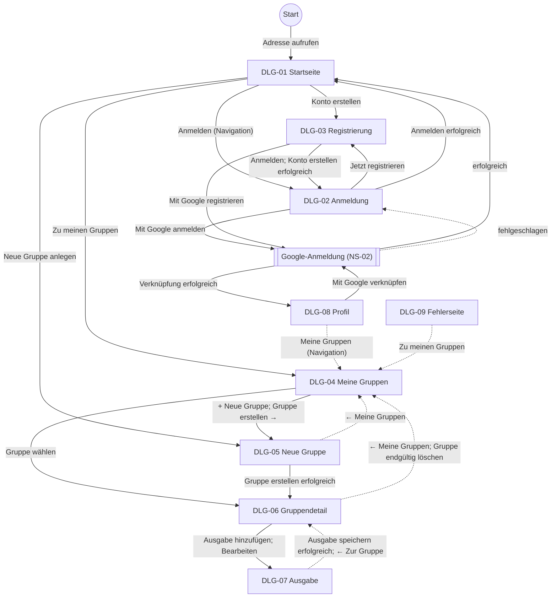

# B1  Dialogspezifikation

B1 beschreibt jede Maske von CampusSplit: was der Benutzer sieht (Statik: Mockup und Feldliste) und was er tun kann (Dynamik: Aktionsliste). Ein Dialog entspricht genau einer Maske. Datentypen und ihre Prüfungen stehen in [D2](D2-datentypenverzeichnis.md), die Attribute in [D1](D1-datenmodell.md).

## B1.1 Dialoglandkarte

Durchgezogene Pfeile führen weiter, gestrichelte zurück. Drei Wechsel gelten von jedem Dialog für angemeldete Benutzer und sind nicht einzeln eingezeichnet:

| Auslöser (Navigation) | Ziel |
|---|---|
| „Meine Gruppen“ | DLG-04 |
| „Profil“ | DLG-08 |
| „Abmelden“ | DLG-02 (UC-03) |
| Logo „CampusSplit“ | DLG-01 |

Ein Systemereignis führt von jedem Dialog zu DLG-09: Zugriff ohne Recht ([QK-02](N2-querschnittskonzepte.md#n21-berechtigungen)) oder ein Fehler, der im Dialog nicht angezeigt werden kann. Wer nicht angemeldet ist und einen geschützten Dialog aufruft, landet auf DLG-02 ([QK-01](N2-querschnittskonzepte.md#n21-berechtigungen)).

## B1.2 Übersicht

| Dialog | Zweck | Use Cases | Zugang |
|---|---|---|---|
| [DLG-01](#dlg-01--startseite) | Einstieg | — | alle |
| [DLG-02](#dlg-02--anmeldung) | Anmelden | UC-02 | Gast |
| [DLG-03](#dlg-03--registrierung) | Konto anlegen | UC-01 | Gast |
| [DLG-04](#dlg-04--meine-gruppen) | Persönliche Übersicht und Gruppenliste | UC-04 | Benutzer |
| [DLG-05](#dlg-05--neue-gruppe) | Gruppe anlegen | UC-07 | Benutzer |
| [DLG-06](#dlg-06--gruppendetail) | Arbeitsansicht einer Gruppe | UC-08 bis UC-11, UC-14 bis UC-18 | Gruppenmitglied |
| [DLG-07](#dlg-07--ausgabe) | Ausgabe erfassen oder bearbeiten | UC-12, UC-13 | Gruppenmitglied |
| [DLG-08](#dlg-08--profil) | Konto pflegen | UC-05, UC-06 | Benutzer |
| [DLG-09](#dlg-09--fehlerseite) | Fehler melden | alle | alle |

**Meldungen.** Erfolgs- und Fehlermeldungen einer Aktion erscheinen als Hinweis oben im Zieldialog, Feldfehler direkt am Feld. Die Aktionslisten nennen die Meldungen, die nicht schon in F2 stehen.

**Standardaktionen.** Die Navigation (B1.1) ist in allen Dialogen gleich und steht nicht in den Aktionslisten.

## B1.3 Zugang

### DLG-01 Startseite

Die Startseite erklärt CampusSplit in drei Schritten („Gruppe anlegen“, „Ausgaben eintragen“, „Offene Beträge klären“). Sie hat keine Eingabefelder.

| Nr. | Auslöser | Wirkung | Ziel |
|---|---|---|---|
| 1 | „Konto erstellen“ (nur Gast) | — | DLG-03 |
| 2 | „Zu meinen Gruppen“ (nur angemeldet) | — | DLG-04 |
| 3 | „Neue Gruppe anlegen“ (nur angemeldet) | — | DLG-05 |

### DLG-02  Anmeldung

| Feld | Typ (D2) | Vorbelegung | Muss/Kann | D1 |
|---|---|---|---|---|
| E-Mail-Adresse | E-Mail-Adresse | leer | Muss | User.email |
| Passwort | Passwort | leer | Muss | User.passwordHash |

| Nr. | Auslöser | Wirkung | Ziel |
|---|---|---|---|
| 1 | „Anmelden“ | UC-02 | DLG-01 |
| 2 | „Mit Google anmelden“ (nur wenn eingeschaltet) | UC-02, 1a | NS-02, dann DLG-01 |
| 3 | „Jetzt registrieren“ | — | DLG-03 |

Hinweise oben: nach Registrierung, nach Abmeldung, nach fehlgeschlagener Google-Anmeldung.

### DLG-03 Registrierung

| Feld | Typ (D2) | Vorbelegung | Muss/Kann | D1 |
|---|---|---|---|---|
| Anzeigename | Anzeigename | leer | Muss | User.name |
| E-Mail-Adresse | E-Mail-Adresse | leer | Muss | User.email |
| Passwort | Passwort | leer | Muss | User.passwordHash |

| Nr. | Auslöser | Wirkung | Ziel |
|---|---|---|---|
| 1 | „Konto erstellen“ | UC-01 | DLG-02; bei Fehler bleibt DLG-03 mit Feldfehlern |
| 2 | „Mit Google registrieren“ (nur wenn eingeschaltet) | UC-01, 2a | NS-02, dann DLG-01 |
| 3 | „Anmelden“ | — | DLG-02 |

## B1.4 Übersicht

### DLG-04 Meine Gruppen

| Anzeigefeld | Typ (D2) | Herkunft |
|---|---|---|
| Währung | Währungscode | Group.currency |
| Du bekommst zurück, Du schuldest, Ausgaben diesen Monat (je Währung und „Gesamt in EUR“) | Geldbetrag | AF-06 |
| Gruppenname, Beschreibung (je Gruppe) | Gruppenname, Freitext (500) | Group.name, Group.description |
| Gruppenwährung (je Gruppe) | Währungscode | Group.currency |
| Rolle (je aktiver Gruppe) | Rolle | Membership.role |
| „Archiviert“ (je archivierter Gruppe) | Text | Group.archivedAt |

| Nr. | Auslöser | Wirkung | Ziel |
|---|---|---|---|
| 1 | „+ Neue Gruppe“ oder „Gruppe erstellen →“ | — | DLG-05 |
| 2 | Archivierte Gruppen aufklappen | zeigt die archivierten Gruppen | DLG-04 |
| 3 | Gruppe wählen | UC-08 | DLG-06 |

Zustände: Ohne aktive Gruppe steht „Keine aktiven Gruppen.“ mit „Gruppe erstellen →“. Fehlt ein Kurs, zeigt die Zeile „Gesamt in EUR“ statt Beträgen einen Hinweis (AF-06).

## B1.5 Gruppen

### DLG-05  Neue Gruppe

| Feld | Typ (D2) | Vorbelegung | Muss/Kann | D1 |
|---|---|---|---|---|
| Gruppenname | Gruppenname | leer | Muss | Group.name |
| Beschreibung | Freitext (500) | leer | Kann | Group.description |
| Gruppenwährung | Währungscode | Euro (EUR) | Muss | Group.currency |

| Nr. | Auslöser | Wirkung | Ziel |
|---|---|---|---|
| 1 | „Gruppe erstellen“ | UC-07 | DLG-06; bei Fehler bleibt DLG-05 mit Feldfehlern |
| 2 | „← Meine Gruppen“ | verwirft die Eingaben | DLG-04 |

### DLG-06  Gruppendetail

DLG-06 ist die Arbeitsansicht einer Gruppe. Die Maske besteht aus Bereichen; jeder Bereich mit Eingaben ist ein eigenes Formular mit eigener Schaltfläche.

**Anzeigebereiche**

| Bereich | Anzeigefeld | Typ (D2) | Herkunft |
|---|---|---|---|
| Kopf | Gruppenname, Gruppenwährung | Gruppenname, Währungscode | Group |
| Kopf | Hinweis „archiviert“, nur bei archivierter Gruppe | Text | Group.archivedAt |
| Salden | Name, Stand („bekommt zurück“ / „schuldet noch“ / „ausgeglichen“), Betrag | Anzeigename, Text, Geldbetrag | AF-02 |
| Wer zahlt wem? | „Schuldner → Gläubiger“, Betrag | Anzeigename, Geldbetrag | AF-03 |
| Ausgaben | Datum, Beschreibung, Zahler, Kategorie, Abrechnungsbetrag | Datum, Freitext (250), Anzeigename, Kategorie, Geldbetrag | Expense |
| Ausgaben | nur bei Fremdwährung: Originalbetrag, Kurs, Kursdatum | Geldbetrag, Wechselkurs, Datum | Expense |
| Kostenanteile und Belege (aufklappbar) | Name und Anteil je Beteiligtem; Dateiname je Beleg | Anzeigename, Geldbetrag, Dateiname | ExpenseShare, Receipt |
| Aktivitäten | Zeitpunkt, Person, Art und geänderte Felder | Zeitpunkt, Anzeigename, Freitext | ExpenseChange |
| Aktivitäten | Rückzahlung: Datum, Sender, Empfänger, Betrag, zugeordnete Ausgabe, Status, bei Stornierung Grund | Datum, Anzeigename, Geldbetrag, Freitext (250) | Repayment |
| Mitglieder | Name, Rolle | Anzeigename, Rolle | Membership |

**Formulare und Feldliste**

| Formular | Feld | Typ (D2) | Vorbelegung | Muss/Kann | D1 |
|---|---|---|---|---|---|
| Rückzahlung (je Vorschlag) | Zurückgezahlter Betrag | Geldbetrag | Vorschlagsbetrag | Muss | Repayment.amount |
| Einzelne Ausgabe begleichen (je Ausgabe aus AF-05) | Dein Rückzahlungsbetrag | Geldbetrag | offener Betrag | Muss | Repayment.amount, expenseId |
| Beleg hinzufügen (je Ausgabe) | Datei | Belegdatei | — | Muss | Receipt |
| Rückzahlung stornieren (je Rückzahlung) | Grund | Freitext (250) | leer | Muss | Repayment.cancellationReason |
| Mitglied per E-Mail hinzufügen | E-Mail-Adresse | E-Mail-Adresse | leer | Muss | Membership |
| Abrechnung herunterladen | Inhalt | Abrechnungsinhalt | Gesamte Abrechnung | Muss | — |
| Abrechnung herunterladen | Format | Abrechnungsformat | PDF | Muss | — |
| Gruppe löschen | Gruppenname zur Bestätigung | Gruppenname | leer | Muss | Group.name |

**Aktionsliste**

| Nr. | Auslöser | Wirkung | Ziel / Meldung |
|---|---|---|---|
| 1 | „Ausgabe hinzufügen“ | — | DLG-07 leer |
| 3 | „Einzelne Ausgabe begleichen (optional)“ aufklappen, Betrag bei einer Ausgabe eingeben, dort „Zahlung erfassen“ | UC-16, 1a | DLG-06; ohne zuordenbare Ausgabe steht „Keine einzelne Ausgabe direkt zuordenbar. Nutze den Gesamtbetrag oben; Gruppenschulden können miteinander verrechnet sein.“ |
| 4 | „Zahlung erfassen“ mit dem Betrag aus Feld 2 | UC-16 | DLG-06 mit neuen Salden |
| 5 | „Bearbeiten“ | — | DLG-07 mit den Werten der Ausgabe |
| 6a | „Kostenanteile und Belege“ aufklappen, „Beleg hinzufügen“, Datei wählen, „Beleg speichern“ | UC-15 | DLG-06: „Beleg hochgeladen.“ |
| 6b | Dateiname eines Belegs wählen | UC-15, 1a | Datei zum Herunterladen |
| 6c | „Beleg entfernen“ | UC-15, 1b | DLG-06: „Beleg entfernt.“ |
| 6d | „Ausgabe löschen“ | UC-14 | DLG-06: „Ausgabe gelöscht.“; bei Konflikt DLG-09 |
| 7 | Filter „Alle“, „Ausgaben“, „Belege“, „Rückzahlungen“ | zeigt nur Aktivitäten dieser Art | DLG-06 |
| 8 | „Rückzahlung stornieren“ aufklappen, Grund, „Stornierung bestätigen“ | UC-17 | DLG-06: „Rückzahlung storniert. Die Salden wurden neu berechnet.“ |
| 10 | „Hinzufügen“ mit der E-Mail-Adresse aus Feld 9 | UC-09 | DLG-06: „Mitglied hinzugefügt.“ |
| 13 | „Herunterladen“ mit Inhalt aus Feld 11 und Format aus Feld 12 | UC-18 | Datei nach B3; DLG-06 bleibt |
| 14 | „Gruppe archivieren“ bzw. „Gruppe wiederherstellen“ aufklappen und wählen | UC-10 | DLG-06: „Gruppe archiviert. Sie bleibt im Archiv einsehbar.“ / „Gruppe wiederhergestellt.“ |
| 15a | „Gruppe löschen“ aufklappen, Namen eingeben, „Gruppe endgültig löschen“ | UC-11 | DLG-04: „Die Gruppe wurde gelöscht.“; bei falschem Namen DLG-06 |
| 15b | „Abbrechen“ im Bereich „Gruppe löschen“ | klappt den Bereich zu | DLG-06 |

**Zustände.** Was sichtbar ist, hängt von der Rolle und vom Vorschlag ab ([N2.1](N2-querschnittskonzepte.md#n21-berechtigungen)):

| Element | sichtbar für |
|---|---|
| 2, 3, 4 Rückzahlung erfassen | Schuldner und Gläubiger des Vorschlags, Gruppenadministrator |
| 8 Rückzahlung stornieren | Sender und Empfänger der Rückzahlung, Gruppenadministrator; nur solange nicht storniert |
| 9, 10, 14, 15 | Gruppenadministrator |

Ohne Ausgaben steht „Noch keine Ausgaben. Erfasse euren ersten gemeinsamen Einkauf.“, ohne offene Beträge „Alle Salden sind ausgeglichen.“, ohne Aktivitäten „Noch keine Aktivitäten in dieser Ansicht.“

### DLG-07  Ausgabe

Derselbe Dialog dient zum Erfassen (Titel „Ausgabe erfassen“) und Bearbeiten (Titel „Ausgabe bearbeiten“).

| Feld | Typ (D2) | Vorbelegung beim Erfassen | Muss/Kann | D1 | Prüfung |
|---|---|---|---|---|---|
| Beschreibung | Freitext (250) | leer | Muss | Expense.description | — |
| Betrag | Geldbetrag | leer | Muss | Expense.originalAmount | ab 0,01 |
| Währung | Währungscode | Gruppenwährung | Muss | Expense.originalCurrency | — |
| Datum | Datum | heute | Muss | Expense.expenseDate | nicht nach heute (INV-07) |
| Kategorie | Kategorie | Ohne Kategorie | Kann | Expense.category | — |
| Bezahlt von | Mitglied der Gruppe | angemeldeter Benutzer | Muss | Expense.paidBy | INV-04 |
| Aufteilung | Aufteilungsart | Gleichmäßig | Muss | Expense.splitMethod | — |
| Beteiligte | Mitglieder der Gruppe | alle Mitglieder | Muss | ExpenseShare.user | mindestens einer, INV-04 |
| Betrag je Beteiligtem | Geldbetrag | leer | Muss bei „Individuelle Beträge“ | ExpenseShare.shareAmount | AF-01 |

Beim Bearbeiten sind alle Felder mit den gespeicherten Werten vorbelegt.

| Nr. | Auslöser | Wirkung | Ziel |
|---|---|---|---|
| 1 | Aufteilung „Individuelle Beträge“ wählen | Die Betragsfelder je Beteiligtem werden genutzt; bei „Gleichmäßig“ bleiben sie unbeachtet. | DLG-07 |
| 2 | Beteiligten an- oder abwählen | — | DLG-07 |
| 3 | „Ausgabe speichern“ | UC-12 bzw. UC-13 | DLG-06; bei Fehler bleibt DLG-07 mit Meldung und allen Eingaben |
| 4 | „← Zur Gruppe“ | verwirft die Eingaben | DLG-06 |

## B1.6 Konto

### DLG-08 Profil

| Feld | Typ (D2) | Vorbelegung | Muss/Kann | D1 |
|---|---|---|---|---|
| E-Mail-Adresse | E-Mail-Adresse (nur Anzeige) | eigene | — | User.email |
| Anzeigename | Anzeigename | eigener | Muss | User.name |
| Status der Google-Anmeldung | Anzeige: „Google ist mit deinem Konto verknüpft.“; bei ausgeschalteter Google-Anmeldung „Google-Anmeldung ist derzeit nicht aktiviert.“ | — | — | User.googleSubject |
| Aktuelles CampusSplit-Passwort | Passwort | leer | Muss für Nr. 2; nur sichtbar, solange nicht verknüpft | User.passwordHash |

| Nr. | Auslöser | Wirkung | Ziel / Meldung |
|---|---|---|---|
| 1 | „Änderungen speichern“ | UC-05 | DLG-08: „Anzeigename gespeichert.“ |
| 2 | „Mit Google verknüpfen“ (nur wenn eingeschaltet und nicht verknüpft) | UC-06 | NS-02, dann DLG-08 |

### DLG-09 Fehlerseite

Zeigt „Das hat nicht geklappt.“ und die Meldung, zum Beispiel „Du hast keinen Zugriff auf diese Gruppe oder Aktion.“ oder „Die Daten wurden inzwischen geändert oder der Eintrag existiert bereits. Bitte neu laden.“ Ohne eigene Meldung: „Bitte prüfe deine Eingaben oder versuche es später erneut.“

| Nr. | Auslöser | Wirkung | Ziel |
|---|---|---|---|
| 1 | „Zu meinen Gruppen“ | — | DLG-04 |

## B1.7 Quellen der Mockups

Die Mockups sind Wireframes mit Beispieldaten. Sie entstehen aus [diagramme/mockups.py](diagramme/mockups.py); die Nummern im Mockup sind die Nummern der Aktionsliste.
