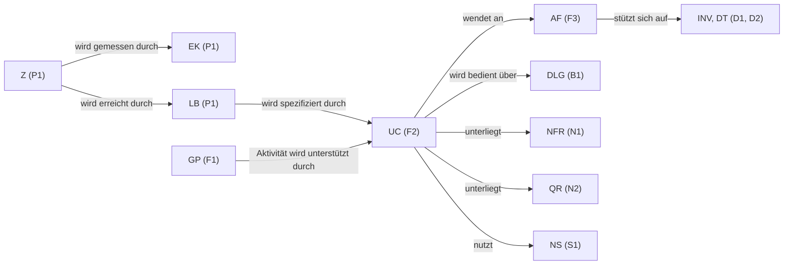

# E1 — Leseanleitung

E1 erklärt, wie die Spezifikation von CampusSplit aufgebaut ist, in welcher Reihenfolge sie gelesen werden sollte und welche Konventionen in allen Bausteinen gelten. Die Konventionen sind verbindlich: Ein Baustein, der von ihnen abweicht, gilt als fehlerhaft.
---

## E1.1 Zweck und Zielgruppen

Die Spezifikation legt fest, **was** CampusSplit fachlich leisten muss. Sie ist die Vorgabe für Implementierung und Test: Ändert sich das Verhalten der Anwendung, wird zuerst die Spezifikation geändert, dann der Code. Wie das System technisch aufgebaut ist, beschreibt die Architekturdokumentation im Ordner [Architektur](../Architektur/).

| Zielgruppe | Nutzt die Spezifikation, um … |
| --- | --- |
| Modulverantwortliche (Auftraggeber, Prüfende) | Umfang, Ziele und Erfolgskriterien zu prüfen und die Abnahme vorzubereiten |
| Software Architect | die fachlichen Vorgaben für die Architektur abzuleiten |
| Implementation Lead und Entwickelnde | Abläufe, Regeln, Daten und Dialoge umzusetzen |
| QA/Test Lead | Testfälle aus Akzeptanzkriterien, Erfolgskriterien und nichtfunktionalen Anforderungen abzuleiten |
| Benutzervertreter (z. B. Mitglieder einer Test-WG) | zu prüfen, ob die Anwendung ihre Situation abbildet |

## E1.2 Aufbau der Spezifikation

Die Spezifikation folgt den Bausteinen nach Siedersleben. Jeder Baustein steht in einer eigenen Datei im Ordner `Spezifikation/`.

| Gruppe | Baustein | Inhalt | Status |
| --- | --- | --- | --- |
| Projektgrundlagen | [P1 – Ziele und Rahmenbedingungen](P1_Ziele_und_Rahmenbedingungen.md) | Ausgangssituation, Ziele mit Erfolgskriterien, Leistungsumfang, Nichtziele, Rahmenbedingungen, Annahmen, Risiken | vorhanden |
| | [P2 – Architekturüberblick](P2_Architekturueberblick.md) | System als Black Box mit Akteuren und Nachbarsystemen | vorhanden |
| Fachliches Modell: Abläufe und Funktionen | [F1 – Geschäftsprozesse](F1-geschaeftsprozesse.md) | Wiederkehrende Abläufe der Gruppen mit manuellen und unterstützten Aktivitäten | vorhanden |
| | [F2 – Anwendungsfälle](F2-anwendungsf%C3%A4lle.md) | Anwendungsfalldiagramm und Anwendungsfälle mit Akzeptanzkriterien | vorhanden |
| | [F3 – Anwendungsfunktionen](F3-anwendungsfunktionen.md) | Fachliche Rechenregeln und Prüfungen (Aufteilung, Umrechnung, Saldo, Ausgleich) | vorhanden |
| Fachliches Modell: Daten | [D1 – Datenmodell](D1_Datenmodell.md) | Fachliche Entitäten, Beziehungen, Invarianten | vorhanden |
| | [D2 – Datentypenverzeichnis](D2_Datentypenverzeichnis.md) | Fachliche Datentypen mit Wertebereich | vorhanden |
| Fachliches Modell: Benutzerschnittstelle | [B1 – Dialogspezifikation](B1_Dialogspezifikation.md) | Dialoglandkarte, Dialoge mit Feldern, Aktionen und Mockups | vorhanden |
| | B2 – Batchspezifikation | – | **entfällt**: CampusSplit hat keine zeitgesteuerten Verarbeitungen; Salden und Vorschläge werden bei jeder Anzeige neu ermittelt. |
| | [B3 – Druckausgaben](B3_Druckausgaben.md) | Abrechnung als PDF und als Tabellendateien | vorhanden |
| Fachliches Modell: Umgebung | [S1 – Nachbarsysteme](S1_Nachbarsysteme.md) | Fachliche Schnittstellen zu NS-01 und NS-02 im Detail | vorhanden |
| | S2 – Migration | – | **entfällt**: Es werden keine Altdaten übernommen ([NZ-04](P1_Ziele_und_Rahmenbedingungen.md#p16-nichtziele)). |
| | [S3 – Inbetriebnahme](S3_Inbetriebnahme.md) | Voraussetzungen und Schritte der fachlichen Inbetriebnahme, Abnahmetest | vorhanden |
| Nichtfunktionale Anforderungen | [N1 – Nichtfunktionale Anforderungen](N1_Nichtfunktionale%20Anforderungen.md) | Qualitätsanforderungen mit Fit Criterion, Mengengerüst | vorhanden |
| | [N2 – Querschnittskonzepte](N2_Querschnittskonzepte.md) | Fachliche Querschnittsregeln (Rechte, Meldungen, Protokollierung) | vorhanden |
| Ergänzendes | E1 – Leseanleitung | dieser Baustein | vorhanden |
| | [E2 – Glossar](E2_Glossar.md) | Fachbegriffe mit Definition und Synonymregelung | vorhanden |

## E1.3 Lesereihenfolge

Allen Zielgruppen wird empfohlen, mit P1 und P2 zu beginnen und das Glossar E2 beim Lesen offen zu halten.

| Zielgruppe | Empfohlene Reihenfolge |
| --- | --- |
| Erster Überblick | P1 → P2 → F1 → Anwendungsfalldiagramm in F2 |
| Modulverantwortliche | P1 → P2 → F1 → F2 → N1 → S3 |
| Software Architect | P1 → P2 → S1 → D1 → D2 → N1 → N2 |
| Entwickelnde | F2 → F3 → D1 → D2 → B1 → B3 → N2 |
| QA/Test | P1.4 (Erfolgskriterien) → F2 (Akzeptanzkriterien) → F3 → N1 → S3 |
| Benutzervertreter | P1.2 → F1 → B1 (Mockups) |

## E1.4 Konventionen

**Sprache und Begriffe**

- Die Spezifikation ist auf Deutsch geschrieben.
- Fachbegriffe werden ausschließlich so verwendet, wie sie in [E2](E2_Glossar.md) definiert sind. Begriffe in der Spalte „Nicht verwenden“ sind ausgeschlossen. Insbesondere heißt es immer **Benutzer** (nicht „Nutzer“ oder „User“), **Gruppenadministrator** (nicht „Administrator“, „Admin“ oder „Gruppenersteller“), **Schuldner** und **Gläubiger** (nicht „Debitor“ und „Kreditor“).
- Verbindlichkeit: „muss“ ist verbindlich, „soll“ ist angestrebt und wird bei der Abnahme bewertet, „kann“ ist optional.
- Die Spezifikation beschreibt fachlich. Namen von Klassen, Tabellen, Spalten, Adressen (Routen), Parametern, Programmiersprachen und Frameworks gehören in die Architekturdokumentation, nicht in die Spezifikation.

**Werte und Darstellung**

- Geldbeträge mit zwei Nachkommastellen, Komma als Dezimaltrennzeichen, Punkt als Tausendertrennzeichen und Währungscode nach dem Betrag: `1.234,56 EUR`.
- Datumsangaben als `TT.MM.JJJJ`, Uhrzeiten als `HH:MM` in deutscher Zeit (Europe/Berlin).

**Form der Bausteine**

- Titel: `# <Baustein> – <Titel>` mit Halbgeviertstrich, z. B. `# F2 – Anwendungsfälle`.
- Jeder Baustein beginnt mit der Kopftabelle (Bausteingruppe, Stand, Verantwortlich, zugehörige Bausteine) und einem Satz zum Zweck.
- Abschnitte werden durchgängig als `<Baustein>.<Nummer>` nummeriert (z. B. `P1.4`), Unterabschnitte als `<Baustein>.<Nummer>.<Nummer>`. Andere Nummerierungen werden nicht verwendet.
- Tabellen im GitHub-Format (Pipe-Tabellen), damit sie im Repository gerendert werden.
- Diagramme als Mermaid direkt im Markdown. Jedes Diagramm hat eine Legende und wird im Text erläutert. Übersichtsdiagramme stehen vor den Detailbeschreibungen, die sie zusammenfassen (z. B. das Anwendungsfalldiagramm am Anfang von F2).
- Szenarien und Abläufe als nummerierte Markdown-Liste, ein Schritt je Zeile.
- Verweise als relative Links auf den Baustein, bei Bedarf mit Abschnittsanker. Eine ID wird beim ersten Vorkommen in einem Abschnitt verlinkt.

## E1.5 ID-Schema

Alle IDs der Spezifikation folgen dem Format `<Präfix>-<laufende Nummer, zweistellig>`. Andere Präfixe als die folgenden werden nicht verwendet. Eine vergebene ID wird nie neu vergeben; entfällt ein Element, bleibt die ID mit dem Vermerk „entfallen“ stehen.

| Präfix | Bedeutung | Definiert in | Beispiel |
| --- | --- | --- | --- |
| Z | Ziel | P1 | Z-02 |
| EK | Erfolgskriterium | P1 | EK-03 |
| LB | Leistungsbereich | P1 | LB-04 |
| NZ | Nichtziel | P1 | NZ-02 |
| RB | Rahmenbedingung | P1 | RB-05 |
| AN | Annahme | P1 | AN-01 |
| R | Risiko | P1 | R-02 |
| AKT | Akteur | P2 | AKT-03 |
| NS | Nachbarsystem | P2 (Überblick), S1 (Details) | NS-01 |
| GP | Geschäftsprozess; Aktivitäten als `GP-<nn>.A<nn>` | F1 | GP-01, GP-01.A04 |
| UC | Anwendungsfall; Akzeptanzkriterien als `UC-<nn>.AK<nn>` | F2 | UC-08, UC-08.AK02 |
| AF | Anwendungsfunktion (fachliche Regel) | F3 | AF-02 |
| INV | Invariante des Datenmodells | D1 | INV-04 |
| DT | Fachlicher Datentyp | D2 | DT-01 |
| DLG | Dialog | B1 | DLG-07 |
| DA | Druckausgabe | B3 | DA-01 |
| IB | Schritt der Inbetriebnahme | S3 | IB-03 |
| NFR | Nichtfunktionale Anforderung | N1 | NFR-12 |
| QR | Querschnittsregel | N2 | QR-05 |

Entitäten in D1 und Begriffe in E2 haben keine ID; sie werden über ihren Namen referenziert.

## E1.6 Verweiskette

Die Bausteine sind in beide Richtungen verbunden. Damit lässt sich von jedem Ziel bis zur Regel und zum Dialog verfolgen, wie es umgesetzt wird, und umgekehrt.

**Legende:** Kästen sind ID-Arten mit dem Baustein, in dem sie definiert sind. Pfeile werden in Pfeilrichtung gelesen: „Z wird gemessen durch EK“.

Daraus ergeben sich diese Pflichtangaben:

| Element | muss verweisen auf |
| --- | --- |
| Ziel (Z) | seine Erfolgskriterien (EK) und Leistungsbereiche (LB) |
| Anwendungsfall (UC) | Leistungsbereich (LB), unterstützte Aktivität (GP), Akteure (AKT), angewandte Anwendungsfunktionen (AF), Dialoge (DLG), nichtfunktionale Anforderungen (NFR) und Querschnittsregeln (QR), genutzte Nachbarsysteme (NS) |
| Anwendungsfunktion (AF) | Anwendungsfälle (UC), betroffene Entitäten und Invarianten (INV), Datentypen (DT) |
| Dialog (DLG) | Anwendungsfälle (UC) |
| Nichtfunktionale Anforderung (NFR) | Ziel (Z) oder Anwendungsfälle (UC), für die sie gilt |
| Druckausgabe (DA) | Anwendungsfall (UC) und Ziel (Z) |

## E1.7 Konsistenzregeln

1. **Jede Fachregel steht genau einmal**, als Anwendungsfunktion in F3 oder als Invariante in D1. Alle anderen Bausteine verweisen per ID darauf, statt die Regel zu wiederholen.
2. **Die Spezifikation gibt vor.** Ein Baustein beschreibt, wie sich CampusSplit verhalten muss, nicht, was „bereits implementiert“ ist. Nachträge der Art „Erweiterungen der Implementierung“ gibt es nicht; neue Funktionen werden in die betroffenen Bausteine eingearbeitet.
3. **Keine Arbeitsnotizen im Text.** Hinweise wie „muss noch angepasst werden“, leere Überschriften oder Anweisungen an Teammitglieder gehören in die Aufgabenverwaltung des Projekts, nicht in die Spezifikation.
4. **Ein Sachverhalt, eine Aussage.** Widersprechen sich zwei Bausteine, gilt der Baustein, in dem der Sachverhalt nach E1.2 definiert ist, und der andere wird korrigiert.
5. **Begriffe nach E2.** Neue Fachbegriffe werden zuerst in E2 aufgenommen, dann verwendet.

---

## E.1.8 Eingesetzte KI-Werkzeuge

ChatGPT wurde unterstützend für Kürzung, Strukturierung und Formulierung verwendet. Die Inhalte wurden anschließend fachlich geprüft und an die übrigen Spezifikationsbausteine angepasst.

