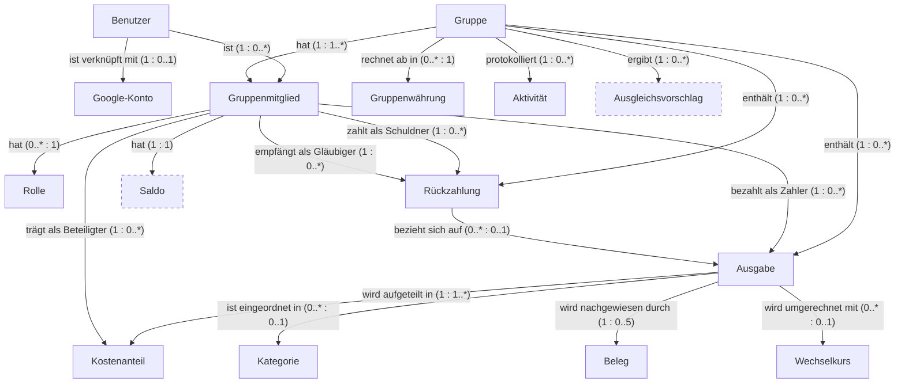

# E2 — Glossar

Das Glossar definiert die **Fachbegriffe** von CampusSplit verbindlich für alle Bausteine ([E1.4](E1_Leseanleitung.md#e14-konventionen)). Methodenbegriffe (z. B. Anwendungsfall, Dialog) und technische Begriffe (z. B. Dateiformate, Datenbank) sind nicht Teil des Glossars. Begriffe in der Spalte „Nicht verwenden“ sind Synonyme, die in der Spezifikation nicht vorkommen dürfen. Rechenregeln werden hier nur benannt; festgelegt sind sie in [F3](F3-anwendungsfunktionen.md) und [D1](D1_Datenmodell.md).

---

## E2.1 Begriffsmodell

Das Begriffsmodell zeigt, wie die zentralen Begriffe zusammenhängen.

**Legende:** Kästen sind Begriffe aus der Tabelle in E2.2. Pfeile werden in Pfeilrichtung gelesen („Gruppe enthält Ausgabe“). Die Angabe in Klammern ist die Kardinalität `(Anfang : Ende)`: „Gruppe enthält Ausgabe (1 : 0..*)“ bedeutet, dass eine Ausgabe zu genau einer Gruppe gehört und eine Gruppe beliebig viele Ausgaben enthält. Gestrichelt umrandete Begriffe werden nicht erfasst, sondern aus anderen Angaben berechnet.

## E2.2 Begriffe

Die Begriffe sind alphabetisch sortiert; Umlaute werden wie der Grundbuchstabe einsortiert.

| Begriff | Definition | Nicht verwenden | Siehe |
| --- | --- | --- | --- |
| Abrechnung | Herunterladbare Zusammenstellung der Daten einer Gruppe zum Weitergeben und Aufbewahren, als PDF-Dokument oder als Tabellendateien in einem ZIP-Archiv. Der Inhalt richtet sich nach dem gewählten Abrechnungsumfang. Jedes Gruppenmitglied kann die Abrechnung herunterladen. | Export, Report, Gruppenabrechnung (nur als Titel des Dokuments) | [B3](B3_Druckausgaben.md), [LB-10](P1_Ziele_und_Rahmenbedingungen.md#p15-leistungsumfang) |
| Abrechnungsbetrag | Betrag einer Ausgabe in der Gruppenwährung. Er entspricht dem Originalbetrag, wenn Originalwährung und Gruppenwährung gleich sind; sonst dem mit dem Wechselkurs umgerechneten und auf ganze Cent gerundeten Originalbetrag. Der Abrechnungsbetrag ist die Grundlage für Kostenanteile und Salden. | umgerechneter Betrag, Gesamtbetrag | [F3](F3-anwendungsfunktionen.md) |
| Abrechnungsumfang | Auswahl, welche Inhalte eine Abrechnung enthält: **gesamte Abrechnung** (Salden, Ausgleichsvorschläge, Ausgaben mit Kostenanteilen, Rückzahlungen), **offene Beträge** (Salden und Ausgleichsvorschläge) oder **nur Ausgaben** (Ausgaben mit Kostenanteilen). | Scope, Exportumfang | [B3](B3_Druckausgaben.md) |
| Aktivität | Unveränderlicher Eintrag im Protokoll einer Gruppe über ein Ereignis: Ausgabe erstellt, geändert oder gelöscht (mit alten und neuen Werten), Beleg hinzugefügt oder entfernt, Rückzahlung erfasst oder storniert. Enthält Zeitpunkt und handelnde Person mit dem Anzeigenamen zum Zeitpunkt des Ereignisses. | Historie, Änderungsverlauf, Log | [D1](D1_Datenmodell.md), [Z-03](P1_Ziele_und_Rahmenbedingungen.md#p14-ziele-und-erfolgskriterien) |
| Anmeldeweg | Art, wie sich ein Benutzer anmeldet: mit E-Mail-Adresse und Passwort oder über die Google-Anmeldung. Ein Benutzerkonto hat mindestens einen Anmeldeweg und kann beide haben. | Login-Methode | [LB-01](P1_Ziele_und_Rahmenbedingungen.md#p15-leistungsumfang) |
| Anzeigename | Name, unter dem ein Benutzer in allen seinen Gruppen erscheint; 1 bis 100 Zeichen, im Profil änderbar. Muss nicht eindeutig sein. | Benutzername, Nickname | [D2](D2_Datentypenverzeichnis.md) |
| Archivierung | Kennzeichnung einer Gruppe als abgeschlossen durch den Gruppenadministrator. Eine archivierte Gruppe erscheint in der Gruppenliste getrennt unter „Archivierte Gruppen“; alle Daten bleiben erhalten und können weiterhin geändert werden. Die Archivierung kann rückgängig gemacht werden (Wiederherstellung). | Deaktivierung, Schließen | [LB-02](P1_Ziele_und_Rahmenbedingungen.md#p15-leistungsumfang) |
| Aufteilungsart | Regel, nach der der Abrechnungsbetrag einer Ausgabe auf die Beteiligten verteilt wird: **gleichmäßig** (alle Beteiligten tragen denselben Betrag, Restcents nach fester Regel) oder **individuelle Beträge** (der Kostenanteil jedes Beteiligten wird eingegeben). | Split-Methode, Verteilungsschlüssel | [F3](F3-anwendungsfunktionen.md), [D2](D2_Datentypenverzeichnis.md) |
| Ausgabe | Betrag, den genau ein Gruppenmitglied (der Zahler) für einen Zweck an einem Tag für die Gruppe vorgestreckt hat und der auf mindestens einen Beteiligten aufgeteilt wird. Eine Ausgabe hat eine Beschreibung (bis 250 Zeichen), Originalbetrag, Originalwährung, Ausgabedatum, Zahler, Aufteilungsart, Kostenanteile, optional eine Kategorie und bis zu fünf Belege. | Kosten, Posten, Buchung, Transaktion | [D1](D1_Datenmodell.md), [LB-03](P1_Ziele_und_Rahmenbedingungen.md#p15-leistungsumfang) |
| Ausgabedatum | Tag, an dem die Ausgabe getätigt wurde. Darf nicht in der Zukunft liegen. Bestimmt den Wechselkurs bei Fremdwährung und die Zuordnung zu einem Monat in der persönlichen Übersicht. | Buchungsdatum | [D1](D1_Datenmodell.md) |
| Ausgleichsvorschlag | Von CampusSplit berechnete Angabe „Schuldner zahlt Gläubiger Betrag“, mit der die Salden einer Gruppe ausgeglichen werden können. Die Vorschläge einer Gruppe bringen zusammen alle Salden auf null. Ein Ausgleichsvorschlag ist keine Zahlung; erst eine erfasste Rückzahlung verändert die Salden. | Ausgleich, Settlement, Überweisungsvorschlag | [F3](F3-anwendungsfunktionen.md) |
| Beleg | Nachweis zu einer Ausgabe, z. B. Kassenzettel oder Rechnung, als Foto (JPEG oder PNG) oder PDF-Dokument mit höchstens 10 MB. Zu einer Ausgabe gehören höchstens fünf Belege. Jedes Gruppenmitglied kann Belege hinzufügen, ansehen und entfernen. Mit der Ausgabe werden auch ihre Belege gelöscht. | Quittung, Anhang, Receipt | [D1](D1_Datenmodell.md), [LB-05](P1_Ziele_und_Rahmenbedingungen.md#p15-leistungsumfang) |
| Benutzer | Person mit Benutzerkonto, die angemeldet ist. | Nutzer, Nutzer:in, User, Anwender | [AKT-02](P2_Architekturueberblick.md#p23-akteure) |
| Benutzerkonto | Zugang einer Person zu CampusSplit mit eindeutiger E-Mail-Adresse (ohne Unterscheidung von Groß- und Kleinschreibung), Anzeigename und mindestens einem Anmeldeweg. Zwei Benutzerkonten werden nie automatisch zusammengeführt. | Account, Profil (Profil bezeichnet nur die Seite der eigenen Kontoangaben) | [D1](D1_Datenmodell.md) |
| Beteiligter | Gruppenmitglied, das an einer Ausgabe einen Kostenanteil trägt. Jede Ausgabe hat mindestens einen Beteiligten; der Zahler kann selbst Beteiligter sein. | Teilnehmer, Mitzahler | [D1](D1_Datenmodell.md) |
| Euroübersicht | Zeile der persönlichen Übersicht, in der die Beträge aller Währungen mit dem aktuellen Wechselkurs in Euro umgerechnet und addiert werden. Dient nur der Information und ist keine Verrechnung. Fehlt ein benötigter Kurs, entfällt die Euroübersicht ganz. | Gesamtsaldo, Verrechnung | [NZ-02](P1_Ziele_und_Rahmenbedingungen.md#p16-nichtziele) |
| Fremdwährung | Originalwährung einer Ausgabe, die von der Gruppenwährung abweicht. Möglich sind nur Euro und US-Dollar, d. h. in einer EUR-Gruppe USD und in einer USD-Gruppe EUR. | Auslandswährung | [LB-04](P1_Ziele_und_Rahmenbedingungen.md#p15-leistungsumfang) |
| Gast | Person, die nicht angemeldet ist. | Besucher, anonymer Benutzer | [AKT-01](P2_Architekturueberblick.md#p23-akteure) |
| Gläubiger | Gruppenmitglied mit positivem Saldo: Es hat mehr für die Gruppe geleistet, als ihm zuzurechnen ist, und bekommt Geld zurück. Bei einer Rückzahlung der Empfänger. | Kreditor, Empfänger (außer bei der Rückzahlung) | [F3](F3-anwendungsfunktionen.md) |
| Google-Anmeldedienst | Nachbarsystem, über das sich eine Person mit ihrem Google-Konto anmeldet und das CampusSplit die bestätigte Identität mitteilt. | Google OAuth, Google Login | [NS-02](P2_Architekturueberblick.md#p24-nachbarsysteme), [S1](S1_Nachbarsysteme.md) |
| Google-Anmeldung | Optionaler Anmeldeweg über ein Google-Konto. Gibt es zur bestätigten E-Mail-Adresse noch kein Benutzerkonto, entsteht bei der ersten Google-Anmeldung ein neues Konto ohne Passwort. Gibt es bereits ein Konto mit dieser E-Mail-Adresse, wird die Anmeldung abgelehnt; das Konto kann nur über die Kontoverknüpfung mit Google verbunden werden. | Social Login, SSO | [LB-01](P1_Ziele_und_Rahmenbedingungen.md#p15-leistungsumfang) |
| Google-Konto | Konto einer Person bei Google, das über eine dauerhafte Google-Kennung erkannt wird, nicht über die E-Mail-Adresse. Ein Google-Konto kann mit höchstens einem Benutzerkonto verknüpft sein und umgekehrt. | Google-Account | [D1](D1_Datenmodell.md) |
| Gruppe | Zusammenschluss von Benutzern, die gemeinsame Ausgaben abrechnen, z. B. eine WG oder eine Reisegruppe. Hat einen Namen (bis 100 Zeichen), eine optionale Beschreibung (bis 500 Zeichen), eine Gruppenwährung und ist aktiv oder archiviert. | Team, Projekt, Abrechnungsgruppe | [D1](D1_Datenmodell.md), [LB-02](P1_Ziele_und_Rahmenbedingungen.md#p15-leistungsumfang) |
| Gruppenadministrator | Rolle des Gruppenmitglieds, das die Gruppe angelegt hat. Jede Gruppe hat genau einen Gruppenadministrator; die Rolle wird nicht übertragen. Darf zusätzlich zu einem Gruppenmitglied Mitglieder hinzufügen, die Gruppe archivieren, wiederherstellen und löschen sowie Rückzahlungen für andere Mitglieder erfassen und stornieren. | Administrator, Admin, Gruppenersteller, Owner, Besitzer | [AKT-04](P2_Architekturueberblick.md#p23-akteure), [N2](N2_Querschnittskonzepte.md) |
| Gruppenlöschung | Endgültiges Entfernen einer Gruppe durch den Gruppenadministrator nach Eingabe des exakten Gruppennamens. Gelöscht werden alle Ausgaben, Kostenanteile, Belege, Rückzahlungen, Aktivitäten und Mitgliedschaften der Gruppe; die Benutzerkonten bleiben erhalten. Nicht rückgängig zu machen. | Löschen (ohne Zusatz), Entfernen | [LB-02](P1_Ziele_und_Rahmenbedingungen.md#p15-leistungsumfang) |
| Gruppenmitglied | Benutzer, der einer bestimmten Gruppe angehört, mit der Rolle Mitglied oder Gruppenadministrator. Wird vom Gruppenadministrator über die E-Mail-Adresse seines Benutzerkontos hinzugefügt und verbleibt in der Gruppe. Sieht alle Inhalte der Gruppe und darf jede Ausgabe erfassen, ändern und löschen. | Teilnehmer, Mitbewohner, Member | [AKT-03](P2_Architekturueberblick.md#p23-akteure) |
| Gruppenwährung | Währung einer Gruppe, Euro (EUR) oder US-Dollar (USD), beim Anlegen festgelegt und danach nicht änderbar. Abrechnungsbeträge, Kostenanteile, Salden, Ausgleichsvorschläge und Rückzahlungen der Gruppe lauten immer auf die Gruppenwährung. | Hauptwährung, Basiswährung, Abrechnungswährung | [D2](D2_Datentypenverzeichnis.md) |
| Kategorie | Optionale Einordnung einer Ausgabe aus einer festen Liste: Fahrtkosten, Freizeit, Haushalt, Lebensmittel, Sonstiges, Unterkunft. Benutzer können keine Kategorien anlegen. | Typ, Tag | [NZ-08](P1_Ziele_und_Rahmenbedingungen.md#p16-nichtziele) |
| Kontoverknüpfung | Verbinden eines bestehenden Benutzerkontos mit einem Google-Konto, ausgelöst im Profil nach Bestätigung des aktuellen Passworts. Danach stehen beide Anmeldewege zur Verfügung; Gruppen, Ausgaben und E-Mail-Adresse bleiben unverändert. | Zusammenführung, Merge | [LB-01](P1_Ziele_und_Rahmenbedingungen.md#p15-leistungsumfang) |
| Kostenanteil | Teil des Abrechnungsbetrags einer Ausgabe, den ein Beteiligter trägt; centgenau und nicht negativ. Die Kostenanteile einer Ausgabe ergeben zusammen genau ihren Abrechnungsbetrag (Regel in [F3](F3-anwendungsfunktionen.md)). | Anteil (ohne Zusatz), Share | [D1](D1_Datenmodell.md) |
| Kursdatum | Tag, für den ein Wechselkurs veröffentlicht wurde. Liegt nie nach dem Ausgabedatum; an Tagen ohne Veröffentlichung gilt der letzte veröffentlichte Kurs davor. | Stichtag | [RB-05](P1_Ziele_und_Rahmenbedingungen.md#p17-rahmenbedingungen) |
| Monatsausgaben | Summe der eigenen Kostenanteile eines Benutzers aus Ausgaben, deren Ausgabedatum im laufenden Kalendermonat liegt, je Währung über alle seine Gruppen. In der persönlichen Übersicht als „Ausgaben diesen Monat“ bezeichnet. | Monatsbudget | [LB-09](P1_Ziele_und_Rahmenbedingungen.md#p15-leistungsumfang) |
| Originalbetrag | Betrag einer Ausgabe in der Originalwährung, wie er auf dem Beleg steht; positiv und centgenau. | Rechnungsbetrag | [D1](D1_Datenmodell.md) |
| Originalwährung | Währung, in der eine Ausgabe bezahlt wurde: Euro (EUR) oder US-Dollar (USD). | Belegwährung | [D2](D2_Datentypenverzeichnis.md) |
| Persönliche Übersicht | Zusammenfassung für den angemeldeten Benutzer über alle seine Gruppen, getrennt nach Währung: was er zurückbekommt (Summe seiner positiven Salden), was er schuldet (Summe seiner negativen Salden) und seine Monatsausgaben; ergänzt um die Euroübersicht. | Dashboard, Startseite | [LB-09](P1_Ziele_und_Rahmenbedingungen.md#p15-leistungsumfang) |
| Restcent | Cent, der bei gleichmäßiger Aufteilung übrig bleibt, weil sich der Abrechnungsbetrag nicht ohne Rest durch die Anzahl der Beteiligten teilen lässt (z. B. 10,00 EUR auf drei Beteiligte: 3,34 + 3,33 + 3,33). Welche Beteiligten einen Restcent tragen, legt eine feste Regel in [F3](F3-anwendungsfunktionen.md) fest. | Rundungsdifferenz | [F3](F3-anwendungsfunktionen.md) |
| Rolle | Stellung eines Gruppenmitglieds in einer Gruppe: Mitglied oder Gruppenadministrator. Bestimmt die Rechte in dieser Gruppe. | Berechtigung, Status | [N2](N2_Querschnittskonzepte.md) |
| Rückzahlung | In CampusSplit erfasste Zahlung, die ein Schuldner außerhalb von CampusSplit an einen Gläubiger derselben Gruppe geleistet hat. Lautet auf die Gruppenwährung, ist höchstens so hoch wie der offene Ausgleichsvorschlag zwischen beiden und kann optional einer Ausgabe des Gläubigers zugeordnet werden. Erfassen dürfen die beiden Beteiligten und der Gruppenadministrator; als Zahlungsdatum gilt der Tag der Erfassung. Eine Rückzahlung wird nicht gelöscht, sondern höchstens storniert. | Zahlung (ohne Zusatz), Ausgleichszahlung, Überweisung, Settlement | [D1](D1_Datenmodell.md), [LB-07](P1_Ziele_und_Rahmenbedingungen.md#p15-leistungsumfang) |
| Saldo | Stand eines Gruppenmitglieds in einer Gruppe in der Gruppenwährung: was es für die Gruppe geleistet hat (Abrechnungsbeträge seiner bezahlten Ausgaben, von ihm geleistete Rückzahlungen) abzüglich dessen, was ihm zuzurechnen ist (seine Kostenanteile, an ihn geleistete Rückzahlungen). Stornierte Rückzahlungen zählen nicht. Positiv: Gläubiger; negativ: Schuldner; null: ausgeglichen. Die Salden einer Gruppe ergeben zusammen null. | Kontostand, Bilanz, offener Betrag | [F3](F3-anwendungsfunktionen.md) |
| Schuldner | Gruppenmitglied mit negativem Saldo: Ihm ist mehr zuzurechnen, als es für die Gruppe geleistet hat, und es schuldet Geld. Bei einer Rückzahlung der Zahlende. | Debitor | [F3](F3-anwendungsfunktionen.md) |
| Stornierung | Kennzeichnung einer Rückzahlung als ungültig, z. B. weil sie versehentlich erfasst wurde, mit Angabe eines Grundes (1 bis 250 Zeichen). Eine stornierte Rückzahlung bleibt mit Grund, Zeitpunkt und stornierender Person sichtbar, zählt aber nicht mehr zum Saldo. Kann nicht rückgängig gemacht werden. Stornieren dürfen die beiden Beteiligten und der Gruppenadministrator. | Löschung, Rückbuchung | [LB-07](P1_Ziele_und_Rahmenbedingungen.md#p15-leistungsumfang) |
| Wechselkurs | Umrechnungsfaktor „1 Einheit Originalwährung = x Einheiten Gruppenwährung“ aus dem Wechselkursdienst für das Ausgabedatum. Wird mit Kursdatum bei der Ausgabe gespeichert und bleibt erhalten, solange Originalbetrag, Originalwährung und Ausgabedatum nicht geändert werden. | Kurs (ohne Zusatz nur im Fließtext zulässig), Umrechnungskurs | [F3](F3-anwendungsfunktionen.md), [RB-05](P1_Ziele_und_Rahmenbedingungen.md#p17-rahmenbedingungen) |
| Wechselkursdienst | Öffentlicher Dienst (Frankfurter), der Tagesreferenzkurse liefert; Nachbarsystem von CampusSplit. | Währungs-API, Kurs-API | [NS-01](P2_Architekturueberblick.md#p24-nachbarsysteme), [S1](S1_Nachbarsysteme.md) |
| Zahler | Gruppenmitglied, das eine Ausgabe bezahlt hat. Jede Ausgabe hat genau einen Zahler. | Bezahler, Käufer | [D1](D1_Datenmodell.md) |

---

## E2.3 Eingesetzte KI-Werkzeuge

ChatGPT (OpenAI) wurde unterstützend für Formulierungen, Kürzung, Strukturierung und Prüfung der Querverweise verwendet. Die fachlichen Inhalte wurden anschließend mit dem Projektkontext und den übrigen Spezifikationsbausteinen abgeglichen.

