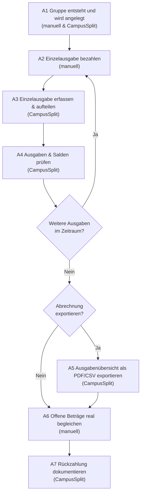

# F1 - Geschäftsprozesse

Ein Geschäftsprozess beschreibt eine zeitlich und logisch geordnete Folge von Aktivitäten aus fachlicher Sicht. Dabei wird der Prozess unabhängig von einer konkreten technischen Implementierung betrachtet.

CampusSplit ist ein unterstützendes IT-System innerhalb dieses Prozesses. Der Prozess beginnt bereits bevor ein Benutzer die Anwendung öffnet, nämlich mit einer gemeinsamen Ausgabe innerhalb einer Gruppe. Er endet nicht zwingend in CampusSplit, sondern erst dann, wenn die Gruppe die offenen Beträge nachvollzogen oder außerhalb des Systems ausgeglichen hat. Die technische Umsetzung dieser realen Abläufe in die Softwarearchitektur wird in den folgenden Kapiteln konkretisiert.

## F1.1 Prozess: Gemeinsame Ausgaben erfassen und ausgleichen

CampusSplit unterstützt einen zentralen, zweiteiligen Geschäftsprozess. Die digitale Erfassung von Gemeinschaftsausgaben und den anschließenden Ausgleich der entstandenen Verbindlichkeiten innerhalb der Gruppe. In der Praxis sieht das so aus, dass eine Person eine Ausgabe für mehrere Gruppenmitglieder bezahlt. Anschließend wird diese Ausgabe dokumentiert, auf die beteiligten Personen verteilt und in Form von Salden sichtbar gemacht.

CampusSplit übernimmt dabei den Teil der strukturierten Erfassung, Berechnung und Darstellung. Die tatsächliche Zahlung zwischen den Gruppenmitgliedern erfolgt außerhalb der Anwendung.

## F1.1.1 Akteure

| Akteur                    | Typ       | Rolle                                                                                                                   |
| ------------------------- | --------- | ----------------------------------------------------------------------------------------------------------------------- |
| Zahlendes Gruppenmitglied | Mensch    | Bezahlt eine Ausgabe und erfasst sie anschließend in CampusSplit.                                                       |
| Weitere Gruppenmitglieder | Mensch    | Sind an Ausgaben beteiligt, prüfen ihre Salden und dokumentieren Rückzahlungen.                                         |
| Gruppenadministrator      | Mensch    | Erstellt und archiviert/löscht Gruppen und verwaltet Gruppenmitglieder.                                                 |
| CampusSplit               | IT-System | Unterstützendes Gesamtsystem zur Erfassung von Ausgaben/Rückzahlungen sowie zur Berechnung und Darstellung von Salden.  |

## F1.1.2 Aktivitäten

Die folgenden Aktivitäten sind in zeitlicher Reihenfolge dargestellt.

| Nr. | Aktivität                                                                         | Unterstützung            | Hinweise                                                                                                     |
| --- | --------------------------------------------------------------------------------- | ------------------------ | ------------------------------------------------------------------------------------------------------------ |
| A1  | Eine Gruppe entsteht, z. B. WG, Reisegruppe oder studentisches Projekt.          | manuell & CampusSplit     | Gruppe entsteht und wird in CampusSplit angelegt.                                                    |
| A2  | Ein Gruppenmitglied bezahlt eine gemeinsame Ausgabe                              | manuell                   | Zum Beispiel Einkauf, Unterkunft, Material oder Fahrtkosten.                                                 |
| A3  | Das Mitglied erfasst die Ausgabe mit Beschreibung, Betrag, Datum und Zahler.     | CampusSplit               | A2 und A3 wiederholen sich für jede weitere Ausgabe im Zeitraum.                                                                               |
| A4  | Gruppenmitglieder prüfen ihre Ausgaben und Salden.                               | CampusSplit               | Transparenz über offene Forderungen und Verbindlichkeiten.                                                   |
| A5 | Bei Bedarf wird eine Ausgabenübersicht exportiert.                                | CampusSplit               | Export als PDF oder CSV.                                                                                     |
| A6 | Gruppenmitglieder gleichen offene Beträge außerhalb von CampusSplit aus.          | manuell                   | Zum Beispiel per Überweisung, PayPal oder Barzahlung. Diese Zahlung wird nicht durch CampusSplit ausgeführt. |
| A7 | Ein Gruppenmitglied dokumentiert die erfolgte Rückzahlung in CampusSplit.         | CampusSplit               | Die erfolgte Zahlung wird in CampusSplit erfasst, sodass der Saldo auf 0,00 € sinkt. |

## F1.1.3 Dokumente und Artefakte

| Dokument / Artefakt     | Entsteht in | Format                                                   |
| ----------------------- | ----------- | -------------------------------------------------------- |
| Reale Ausgabe           | A2          | Fachliches Ereignis außerhalb des Systems                |
| Ausgabeneintrag         | A3          | Strukturierter Datensatz in CampusSPlit                  |
| Kostenanteile           | A3          | Strukturierte Datensätze pro beteiligte Person           |
| Saldenübersicht         | A3-A4       | Berechnete Übersicht innerhalb der Anwendung             |
| Exportdatei             | A5          | PDF oder CSV                                             |
| Realer Zahlungsnachweis | A6          | Außerhalb von CampusSplit, nicht Bestandteil des Systems |
| Rückzahlungseintrag     | A7          | Strukturierter Datensatz in CampusSplit                  |

## F1.1.4 Datenspeicher

| Speicher                                | Verantwortlich  | Enthält                                                                                           |
| --------------------------------------- | --------------- | ------------------------------------------------------------------------------------------------- |
| CampusSplit-Datenhaltung                | CampusSplit     | Benutzer, Gruppen, Ausgaben, Kostenanteile, berechnungsrelevante Daten, Belege und Rückzahlungen  |
| Lokaler Download-Speicher des Benutzers | Benutzer        | Exportierte PDF- oder CSV-Dateien                                                                 |
| Externe Zahlungswege                    | Benutzer        | Tatsächliche Zahlungen zwischen Gruppenmitgliedern, nicht durch CampusSplit verwaltet             |

Die Anwendungsdatenbank ist der zentrale Datenspeicher von CampusSplit. Externe Zahlungswege sind nicht Teil des Systems.

## F1.1.5 Aktivitätsdiagramm

Das folgende Aktivitätsdiagramm zeigt den fachlichen Ablauf des Prozesses.

## F1.2 Rolle der Kostenaufteilung

Die Art der Kostenaufteilung ist ein Parameter des Geschäftsprozesses und kein eigener Prozess.

CampusSplit kann verschiedene Formen der Aufteilung unterstützen:

- gleichmäßige Aufteilung auf alle beteiligten Mitglieder
- individuelle Beträge pro Mitglied
- Ausschluss einzelner Gruppenmitglieder von einer Ausgabe

Die gewählte Aufteilungsart beeinflusst die Berechnung der Kostenanteile und Salden, verändert aber nicht den grundsätzlichen Geschäftsprozess.

Das bedeutet: Eine Ausgabe wird immer erfasst, Beteiligte werden ausgewählt, Kostenanteile werden gespeichert und Salden werden berechnet. Nur die Berechnungsregel unterscheidet sich.

## F1.3 Grenzen des Geschäftsprozesses

Folgende Aktivitäten und Themen sind bewusst nicht Teil des durch CampusSplit unterstützten Prozesses:

| Bereich                                     | Begründung                                                                           |
| ------------------------------------------- | ------------------------------------------------------------------------------------ |
| Zahlungsabwicklung                          | CampusSplit berechnet offene Beträge, führt aber keine Zahlungen aus.                |
| Bankintegration                             | Bankkonten oder Zahlungsanbieter werden nicht angebunden.                            |
| Automatische Rechnungserkennung             | OCR oder Fotoauswertung ist nicht vorgesehen.                                        |
| Rechtliche Prüfung von Ausgaben             | Die Verantwortung für die Richtigkeit der Eingaben liegt bei den Gruppenmitgliedern. |
| Synchronisation mit externen Finanzsystemen | CampusSplit ist ein eigenständiges System ohne externe Finanzschnittstellen.         |
| Gruppenübergreifende Saldenverrechnung      | Salden und Ausgleichsvorschläge werden strikt getrennt pro Gruppe ermittelt.         |
| Unterstützte Währungen                      | Ausschließlich Euro und US-Dollar werden als Währung unterstützt                     |

## F1.5 Querverweise

| Baustein | Relevanz für F1                                                                                                                                         |
| -------- | ------------------------------------------------------------------------------------------------------------------------------------------------------- |
| [P1](P1_Ziele_und_Rahmenbedingungen.md)       | Beschreibt Ziele, Stakeholder, Umfang, Nichtziele und Rahmenbedingungen des Projekts.                              |
| [P2](P2_Architekturueberblick.md)       | Beschreibt die Nachbarsysteme Webbrowser, CampusSplit, Datenbank und Exportdateien.                                      |
| [F2](F2-anwendungsfälle.md)       | Beschreibt die konkreten Use Cases, welche die Aktivitäten A3 bis A7 realisieren.                                              |
| [F3](F3-anwendungsfunktionen.md)       | Beschreibt wiederverwendbare Anwendungsfunktionen wie Validierung, Kostenaufteilung, Saldenberechnung und Exporterzeugung.|
| [D1](D1_Datenmodell.md)       | Beschreibt das Datenmodell für Benutzer, Gruppen, Ausgaben und Kostenanteile.                                                      |
| [D2](D2_Datentypenverzeichnis.md)       | Beschreibt die fachlichen Datentypen und Attribute.                                                                      |
| [B1](B1_Dialogspezifikation.md)       | Beschreibt die Dialoge für Gruppenübersicht, Ausgabenerfassung, Saldenanzeige und Export.                                  |
| [S1](S1_Nachbarsysteme.md)       | Beschreibt Schnittstellen zu Nachbarsystemen, insbesondere Browser, Datenbank und Export.                                       |
| [N1](N1_Nichtfunktionale Anforderungen.md)       | Beschreibt nichtfunktionale Anforderungen wie Sicherheit, Performance, Benutzbarkeit und Datenkonsistenz.       |
