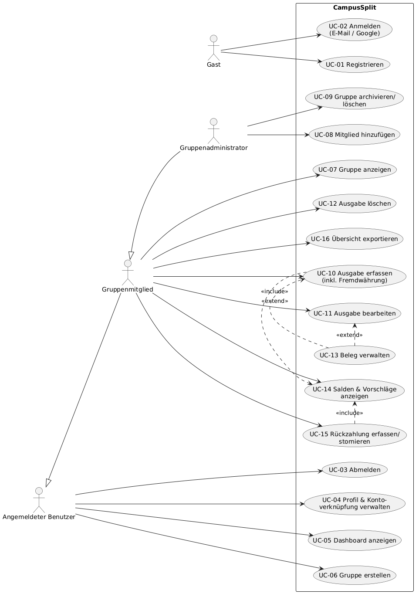

# F2 - Anwendungsfälle

Anwendungsfälle beschreiben konkrete Interaktionsszenarien zwischen Benutzer:innen und CampusSplit. Jeder Anwendungsfall verfolgt ein fachlich sinnvolles Ziel und endet in einem stabilen Systemzustand.

F2 ist der systemgestützte Teil des in F1 beschriebenen Geschäftsprozesses. Aktivitäten außerhalb der Systemgrenze, zum Beispiel das tatsächliche Bezahlen offener Beträge, werden hier nicht als Anwendungsfälle modelliert.

Systeminterne Berechnungen, wie die Saldenberechnung oder Validierung von Eingaben, werden nicht als eigene Use Cases beschrieben. Sie werden in F3 als Anwendungsfunktionen dokumentiert.

##

## F2.1 Use-Case-Index

| ID                                                      | Anwendungsfall                         | Gruppe             | Bezug zu F1-Aktivität      |
| ------------------------------------------------------- | -------------------------------------- | ------------------ | -------------------------- |
| [UC-01](#uc-01--registrieren)                           | Registrieren                   	       | Zugriff            | Voraussetzung für A1-A7    |
| [UC-02](#uc-02--anmelden)                               | Anmelden                               | Zugriff            | Voraussetzung für A1-A7    |
| [UC-03](#uc-03--abmelden)                               | Abmelden                               | Zugriff            | Nachgelagerte Aktion       |
| [UC-04](#uc-04--profil-und-kontoverknüpfung-verwalten)  | Profil & Kontoverknüpfung verwalten    | Zugriff & Konto    | Voraussetzung / Verwaltung |
| [UC-05](#uc-05--dashboard-anzeigen)                     | Dashboard anzeigen                     | Übersicht          | Einstieg in A1/A4          |
| [UC-06](#uc-06--gruppe-erstellen)                       | Gruppe erstellen                       | Gruppenverwaltung  | A1                         |
| [UC-07](#uc-07--gruppe-anzeigen)                        | Gruppe anzeigen                        | Gruppenverwaltung  | A3/A4                      |
| [UC-08](#uc-08--mitglied-zur-gruppe-hinzufügen)         | Mitglied zur Gruppe hinzufügen         | Gruppenverwaltung  | A1                         |
| [UC-09](#uc-09--gruppe-archivieren-oder-löschen)        | Gruppe archivieren oder löschen        | Gruppenverwaltung  | Abschluss nach A7          |
| [UC-10](#uc-10--ausgabe-erfassen)                       | Ausgabe erfassen                       | Ausgabenverwaltung | A3                         |
| [UC-11](#uc-11--ausgabe-bearbeiten)                     | Ausgabe bearbeiten                     | Ausgabenverwaltung | Korrekturfall zu A3-A4     |
| [UC-12](#uc-12--ausgabe-löschen)                        | Ausgabe löschen                        | Ausgabenverwaltung | Korrekturfall zu A3-A4     |
| [UC-13](#uc-13--beleg-anhängen-oder-entfernen)          | Beleg anhängen oder entfernen          | Ausgabenverwaltung | Optionale Erweiterung A3   |
| [UC-14](#uc-14--salden-anzeigen)                        | Salden  anzeigen                       | Saldenverwaltung   | A4                         |
| [UC-15](#uc-15--rückzahlung-erfassen-und-stornieren)    | Rückzahlung erfassen und stornieren    | Saldenverwaltung   | A7                         |
| [UC-16](#uc-16--ausgabenübersicht-exportieren)          | Ausgabenübersicht exportieren          | Export             | A5                         |

##

## F2.2 Use-Case-Diagramm

**Erläuterung der Beziehungen im Use-Case-Diagramm**

Das Diagramm modelliert die Rollenhierarchie sowie die fachlichen Abhängigkeiten zwischen den Anwendungsfällen gemäß UML-Semantik:

- *Gruppenadministrator* &rarr; *Gruppenmitglied*: Ein Gruppenadministrator besitzt sämtliche Rechte eines regulären Gruppenmitglieds und darf darüber hinaus Mitglieder zur Gruppe hinzufügen sowie die Gruppe archivieren oder löschen.

- *Gruppenmitglied* &rarr; *Angemeldeter Benutzer*: Ein Gruppenmitglied erbt alle allgemeinen Anwendungsfälle eines angemeldeten Benutzers (z. B. Dashboard anzeigen, Gruppe erstellen, Profil verwalten, Abmelden) und erhält zusätzlich Zugriff auf gruppenbezogene Funktionen.

- **`<<extend>>` von [UC-13](#uc-13--beleg-anhängen-oder-entfernen) &rarr; [UC-10](#uc-10--ausgabe-erfassen) und [UC-11](#uc-11--ausgabe-bearbeiten)**: Beim Erfassen oder Bearbeiten einer Ausgabe kann ein Gruppenmitglied optional einen oder mehrere Belege (JPEG, PNG oder PDF) hochladen oder bestehende Belege entfernen. Der Basisfall (Erfassen bzw. Bearbeiten der Ausgabe) ist jedoch auch ohne Beleg fachlich vollständig.

- **`<<include>>` von [UC-10](#uc-10--ausgabe-erfassen), [UC-11](#uc-11--ausgabe-bearbeiten), [UC-12](#uc-12--ausgabe-löschen) und [UC-15](#uc-15--rückzahlung-erfassen-und-stornieren) &rarr; [UC-14](#uc-14--salden-anzeigen)**: Jede fachliche Änderung an Ausgaben oder Rückzahlungen führt innerhalb der Gruppenansicht zur Aktualisierung und Anzeige der neu berechneten offenen Salden und Ausgleichsvorschläge.

## 

## F2.3 Zugriff

### UC-01 — Registrieren

| Abschnitt               | Inhalt                                                                                                                                                                                                                                                                                |
| ----------------------- | ------------------------------------------------------------------------------------------------------------------------------------------------------------------------------------------------------------------------------------------------------------------------------------- |
| **Identifier**          | UC-01                                                                                                                                                                                                                                                                                 |
| **Name**                | Registrieren                                                                                                                                                                                                                                                                          |
| **Beschreibung**        | Ein Gast erstellt ein Benutzerkonto, um CampusSplit nutzen zu können.                                                                                                                                                                                                                 |
| **Auslöser**            | Ein Gast möchte CampusSplit erstmalig verwenden.                                                                                                                                                                                                                                      |
| **Akteure**             | Gast                                                                                                                                                                                                                                                                                  |
| **Vorbedingung**        | Der Gast besitzt noch kein Benutzerkonto mit derselben E-Mail-Adresse.                                                                                                                                                                                                                |
| **Nachbedingung**       | Ein neues Benutzerkonto wurde angelegt.                                                                                                                                                                                                                                               |
| **Hauptszenario**       | 1. Gast öffnet die Registrierungsseite.2. System zeigt das Registrierungsformular an.3. Gast gibt Name, E-Mail-Adresse und Passwort ein.4. System validiert die Eingaben.5. System speichert den Benutzer mit gehashtem Passwort.6. System bestätigt die erfolgreiche Registrierung. |
| **Alternativszenarien** | Der Gast bricht die Registrierung ab; es wird kein Konto angelegt.                                                                                                                                                                                                                    |
| **Ausnahmeszenarien**   | E-Mail-Adresse ist bereits vergeben; System zeigt eine Fehlermeldung an. Pflichtfelder fehlen; System markiert die betroffenen Felder. Passwort erfüllt die Mindestanforderungen nicht; System fordert eine Korrektur.                                                                  |
| **Qualitätsbezug**      | N1 Sicherheit, N1 Benutzerfreundlichkeit, N2 Validierung                                                                                                                                                                                                                              |

### UC-02 — Anmelden

| Abschnitt             | Inhalt                                                                                                                                                                                                                                                      |
| --------------------- | ----------------------------------------------------------------------------------------------------------------------------------------------------------------------------------------------------------------------------------------------------------- |
| **Identifier**        | UC-02                                                                                                                                                                                                                                                       |
| **Name**              | Anmelden                                                                                                                                                                                                                                                    |
| **Beschreibung**      | Ein registrierter Benutzer meldet sich mit seinen Zugangsdaten an.                                                                                                                                                                                          |
| **Auslöser**          | Benutzer möchte auf Gruppen, Ausgaben und Salden zugreifen.                                                                                                                                                                                                 |
| **Akteure**           | Gast                                                                                                                                                                                                                                                    |
| **Vorbedingung**      | Benutzerkonto existiert.                                                                                                                                                                                                                                    |
| **Nachbedingung**     | Eine authentifizierte Sitzung ist aktiv.                                                                                                                                                                                                                    |
| **Hauptszenario**     | 1. Gast öffnet die Login-Seite. 2. System zeigt Login-Formular sowie Option „Mit Google anmelden“ an. 3. Gast gibt E-Mail-Adresse und Passwort ein. 4. System prüft Zugangsdaten und erstellt eine authentifizierte Sitzung. 5. Weiterleitung zum Dashboard. |
| **Ausnahmeszenarien** | Zugangsdaten sind falsch; System zeigt eine allgemeine Fehlermeldung an. Benutzerkonto existiert nicht; System zeigt eine allgemeine Fehlermeldung an.                                                                                                      |
| **Qualitätsbezug**    | N1 Sicherheit, N2 Authentifizierung                                                                                                                                                                                                                         |

### UC-03 — Abmelden

| Abschnitt          | Inhalt                                                                                                            |
| ------------------ | ----------------------------------------------------------------------------------------------------------------- |
| **Identifier**     | UC-03                                                                                                             |
| **Name**           | Abmelden                                                                                                          |
| **Beschreibung**   | Ein angemeldeter Benutzer beendet seine aktive Sitzung.                                                           |
| **Auslöser**       | Benutzer möchte CampusSplit verlassen.                                                                            |
| **Akteure**        | Benutzer                                                                                                          |
| **Vorbedingung**   | Benutzer ist angemeldet.                                                                                          |
| **Nachbedingung**  | Keine authentifizierte Sitzung ist aktiv.                                                                         |
| **Hauptszenario**  | 1. Benutzer klickt auf „Abmelden".2. System beendet die Sitzung.3. Benutzer wird zur Login-Seite weitergeleitet. |
| **Qualitätsbezug** | N1 Sicherheit                                                                                                     |

##

## F2.4 Übersicht

### UC-04 — Profil und Kontoverknüpfung verwalten

| Abschnitt             | Inhalt 																													 | 
| --------------------- | -------------------------------------------------------------------------------------------------------------------------- |
| **Identifier**        | UC-04                                                                                                                                                                                                                                                                                                               |
| **Name**              | Profil und Kontoverknüpfung verwalten                                                                                                                                                                                                                                                                               |
| **Beschreibung**      | Benutzer bearbeitet Profildaten (Anzeigename, Passwort) oder verknüpft bzw. trennt sein Google-Konto.                                                                                                                                                                                                               |
| **Auslöser**          | Benutzer möchte Profil bearbeiten oder Konto mit Google verknüpfen                                                                                                                                                                                                                                                  |
| **Akteure**           | Angemeldeter Benutzer                                                                                                                                                                                                                                                                                               |
| **Vorbedingung**      | Benutzer ist angemeldet.                                                                                                                                                                                                                                                                                            |
| **Nachbedingung**     | Profildaten wurden geändert; Konto wurde mit Google verknüpft          .                                                                                                                                                                                                                                            |
| **Hauptszenario**     | 1. Benutzer öffnet die Profileinstellungen. 2. System zeigt Profildaten und aktuellen Status der Google-Kontoverknüpfung an. 3. Benutzer ändert Name/Passwort oder stößt Google-Verknüpfung/-Trennung an. 4. System validiert die Änderung und speichert den neuen Kontostatus. |
| **Ausnahmeszenarien** | Gruppenname fehlt; System fordert eine Eingabe. Gruppenname überschreitet maximale Länge; System zeigt Fehlermeldung.                                                                                                                                                                                               |
| **Qualitätsbezug**    | N1 Benutzerfreundlichkeit, N2 Validierung                                                                                                                                                                                                                                                                           |

### UC-05 — Dashboard anzeigen

| Abschnitt               | Inhalt                                                                                                                                                                                                         |
| ----------------------- | -------------------------------------------------------------------------------------------------------------------------------------------------------------------------------------------------------------- |
| **Identifier**          | UC-05                                                                                                                                                                                                          |
| **Name**                | Dashboard anzeigen                                                                                                                                                                                             |
| **Beschreibung**        | Benutzer erhält eine Übersicht über seine Gruppen und aktuelle offene Salden.                                                                                                                                  |
| **Auslöser**            | Benutzer meldet sich an oder öffnet die Startseite der Anwendung.                                                                                                                                              |
| **Akteure**             | Benutzer                                                                                                                                                                                                       |
| **Vorbedingung**        | Benutzer ist angemeldet.                                                                                                                                                                                       |
| **Nachbedingung**       | Keine Änderung am Datenbestand.                                                                                                                                                                                |
| **Hauptszenario**       | 1. Benutzer öffnet das Dashboard. 2. System lädt alle Gruppen des Benutzers. 3. System zeigt Gruppen, offene Salden und Schnellaktionen an. 4. Benutzer kann eine Gruppe öffnen oder eine neue Gruppe erstellen. |
| **Alternativszenarien** | Benutzer ist noch in keiner Gruppe; System zeigt einen leeren Zustand mit Hinweis zur Gruppenerstellung.                                                                                                       |
| **Qualitätsbezug**      | N1 Benutzerfreundlichkeit, N1 Performance                                                                                                                                                                      |
##

## F2.5 Gruppenverwaltung

### UC-06 — Gruppe erstellen

| Abschnitt             | Inhalt                                                                                                                                                                                                                                                                                                              |
| --------------------- | ------------------------------------------------------------------------------------------------------------------------------------------------------------------------------------------------------------------------------------------------------------------------------------------------------------------- |
| **Identifier**        | UC-06                                                                                                                                                                                                                                                                                                               |
| **Name**              | Gruppe erstellen                                                                                                                                                                                                                                                                                                    |
| **Beschreibung**      | Benutzer erstellt eine neue Gruppe, in der gemeinsame Ausgaben verwaltet werden.                                                                                                                                                                                                                                    |
| **Auslöser**          | Benutzer möchte Ausgaben für eine WG, Reise oder Projektgruppe verwalten.                                                                                                                                                                                                                                           |
| **Akteure**           | Benutzer                                                                                                                                                                                                                                                                                                            |
| **Vorbedingung**      | Benutzer ist angemeldet.                                                                                                                                                                                                                                                                                            |
| **Nachbedingung**     | Eine neue Gruppe wurde erstellt; der Ersteller ist Gruppenadministrator.                                                                                                                                                                                                                                            |
| **Hauptszenario**     | 1. Benutzer wählt „Neue Gruppe erstellen". 2. System zeigt ein Formular für Gruppendaten an. 3. Benutzer gibt Gruppenname, Gruppenwährung (EUR oder USD) und optional Beschreibung ein. 4. System validiert die Eingaben. 5. System speichert die Gruppe. 6. System ordnet den Benutzer als Gruppenadministrator zu. 7. System öffnet die Gruppenseite. |
| **Ausnahmeszenarien** | Gruppenname fehlt; System fordert eine Eingabe. Gruppenname überschreitet maximale Länge; System zeigt Fehlermeldung.                                                                                                                                                                                               |
| **Qualitätsbezug**    | N1 Benutzerfreundlichkeit, N2 Validierung                                                                                                                                                                                                                                                                           |

### UC-07 — Gruppe anzeigen

| Abschnitt             | Inhalt                                                                                                                                                                  |
| --------------------- | ----------------------------------------------------------------------------------------------------------------------------------------------------------------------- |
| **Identifier**        | UC-07                                                                                                                                                                   |
| **Name**              | Gruppe anzeigen                                                                                                                                                         |
| **Beschreibung**      | Benutzer öffnet eine Gruppe und sieht Mitglieder, Ausgaben und Salden.                                                                                                  |
| **Auslöser**          | Benutzer möchte Details einer Gruppe ansehen.                                                                                                                           |
| **Akteure**           | Benutzer                                                                                                                                                                |
| **Vorbedingung**      | Benutzer ist angemeldet und Mitglied der Gruppe.                                                                                                                        |
| **Nachbedingung**     | Keine Änderung am Datenbestand.                                                                                                                                         |
| **Hauptszenario**     | 1. Benutzer wählt eine Gruppe aus. 2. System prüft die Mitgliedschaft. 3. System lädt Gruppendaten, Mitglieder, Ausgaben und Salden. 4. System zeigt die Gruppenseite an. |
| **Ausnahmeszenarien** | Benutzer ist kein Mitglied der Gruppe; Zugriff wird verweigert. Gruppe existiert nicht; System zeigt Fehlermeldung.                                                     |
| **Qualitätsbezug**    | N1 Sicherheit, N1 Performance                                                                                                                                           |

### UC-08 — Mitglied zur Gruppe hinzufügen

| Abschnitt               | Inhalt                                                                                                                                                                                                                                                                                                                                                 |
| ----------------------- | ------------------------------------------------------------------------------------------------------------------------------------------------------------------------------------------------------------------------------------------------------------------------------------------------------------------------------------------------------ |
| **Identifier**          | UC-08                                                                                                                                                                                                                                                                                                                                                  |
| **Name**                | Mitglied zur Gruppe hinzufügen                                                                                                                                                                                                                                                                                                                         |
| **Beschreibung**        | Ein Gruppenadministrator fügt ein weiteres Mitglied zu einer Gruppe hinzu.                                                                                                                                                                                                                                                                             |
| **Auslöser**            | Eine weitere Person soll an der Ausgabenverwaltung teilnehmen.                                                                                                                                                                                                                                                                                         |
| **Akteure**             | Gruppenadministrator                                                                                                                                                                                                                                                                                                                                   |
| **Vorbedingung**        | Benutzer ist angemeldet und Gruppenadministrator der Gruppe.                                                                                                                                                                                                                                                                                           |
| **Nachbedingung**       | Das neue Mitglied ist der Gruppe zugeordnet.                                                                                                                                                                                                                                                                                                           |
| **Hauptszenario**       | 1. Gruppenadministrator öffnet die Mitgliederverwaltung. 2. System zeigt bestehende Mitglieder an. 3. Gruppenadministrator gibt die E-Mail-Adresse des neuen Mitglieds ein. 4. System prüft, ob ein Benutzerkonto mit dieser E-Mail-Adresse existiert. 5. System fügt den Benutzer der Gruppe hinzu. 6. System zeigt die aktualisierte Mitgliederliste an. |
| **Alternativszenarien** | Das Mitglied ist bereits in der Gruppe; System zeigt einen Hinweis ohne Änderung.                                                                                                                                                                                                                                                                      |
| **Ausnahmeszenarien**   | Benutzerkonto existiert nicht; System zeigt Fehlermeldung. Ausführender Benutzer ist kein Gruppenadministrator; Zugriff wird verweigert.                                                                                                                                                                                                               |
| **Qualitätsbezug**      | N1 Sicherheit, N2 Autorisierung, N2 Validierung                                                                                                                                                                                                                                                                                                        |
### UC-09 — Gruppe archivieren oder löschen

| Abschnitt             | Inhalt                                                                                                                                                                                                                                                                                                              |
| --------------------- | ------------------------------------------------------------------------------------------------------------------------------------------------------------------------------------------------------------------------------------------------------------------------------------------------------------------- |
| **Identifier**        | UC-09                                                                                                                                                                                                                                                                                                               |
| **Name**              | Gruppe archivieren oder löschen                                                                                                                                                                                                                                                                                     |
| **Beschreibung**      | Admin archiviert oder löscht eine Gruppe.                                                                                                                                                                                                                                                                           |
| **Auslöser**          | Die Gruppe löst sich auf und muss gelöscht oder archiviert werden                                                                                                                                                                                                                                                   |
| **Akteure**           | Gruppenadministrator                                                                                                                                                                                                                                                                                                |
| **Vorbedingung**      | Benutzer ist Gruppenadministrator; Löschen erfordert die exakte Eingabe des Gruppennamens als Bestätigung.                                                                                                                                                                                                                                                                                   |
| **Nachbedingung**     | Eine neue Gruppe wurde gelöscht; Gruppe wurde archiviert und kann in der Gruppenübersicht wieder hergestellt werden.                                                                                                                                                                                                |
| **Hauptszenario**     | 1. Gruppenadministrator öffnet die Gruppeneinstellungen. 2. Administrator wählt „Gruppe archivieren“ oder „Gruppe löschen“. 3. System fordert eine explizite Bestätigung an. 4. Administrator bestätigt. 5. System setzt die Gruppe auf schreibgeschützt/archiviert bzw. entfernt Gruppe, Ausgaben und Anteile dauerhaft. |
| **Ausnahmeszenarien** | Ausführender Benutzer ist kein Gruppenadministrator; Zugriff wird verweigert.                                                                                                                                                                                               |
| **Qualitätsbezug**    | N1 Sicherheit, N1 Autorisierung, N2 Validierung                                                                                                                                                                                                                                                                     |
##

## F2.6 Ausgabenverwaltung

### UC-10 — Ausgabe erfassen

| Abschnitt               | Inhalt                                                                                                                                                                                                                                                                                                                                                                                                            |
| ----------------------- | ----------------------------------------------------------------------------------------------------------------------------------------------------------------------------------------------------------------------------------------------------------------------------------------------------------------------------------------------------------------------------------------------------------------- |
| **Identifier**          | UC-10                                                                                                                                                                                                                                                                                                                                                                                                             |
| **Name**                | Ausgabe erfassen                                                                                                                                                                                                                                                                                                                                                                                                  |
| **Beschreibung**        | Ein Gruppenmitglied erfasst eine gemeinsame Ausgabe und legt fest, auf welche Mitglieder sie aufgeteilt wird.                                                                                                                                                                                                                                                                                                     |
| **Auslöser**            | Ein Gruppenmitglied hat eine Ausgabe für mehrere Personen bezahlt.                                                                                                                                                                                                                                                                                                                                                |
| **Akteure**             | Gruppenmitglied                                                                                                                                                                                                                                                                                                                                                                                                   |
| **Vorbedingung**        | Benutzer ist angemeldet und Mitglied der Gruppe.                                                                                                                                                                                                                                                                                                                                                                  |
| **Nachbedingung**       | Ausgabe und Kostenanteile wurden gespeichert; Salden können neu berechnet werden.                                                                                                                                                                                                                                                                                                                                 |
| **Hauptszenario**       | 1. Benutzer öffnet eine Gruppe. 2. Benutzer wählt „Ausgabe hinzufügen". 3. System zeigt ein Formular für Beschreibung, Betrag, Währung (EUR oder USD), Datum, Kategorie und Zahler an. 4. Benutzer wählt die beteiligten Gruppenmitglieder aus. 5. Benutzer wählt die Aufteilungsart. 6. System validiert Betrag, Zahler, Beteiligte und Aufteilung. 7. System speichert Ausgabe und Kostenanteile. 8. System aktualisiert die Saldenübersicht. |
| **Alternativszenarien** | Benutzer bricht die Erfassung ab; es wird keine Ausgabe gespeichert. Benutzer wählt nur einen Teil der Gruppenmitglieder aus; Ausgabe wird nur auf diese Personen aufgeteilt.                                                                                                                                                                                                                                     |
| **Ausnahmeszenarien**   | Betrag ist ungültig; System fordert Korrektur. Kein Zahler ausgewählt; System fordert Auswahl. Keine beteiligten Personen ausgewählt; System fordert Auswahl. Aufteilungssumme stimmt nicht mit Gesamtbetrag überein; System zeigt Fehlermeldung.                                                                                                                                                                 |
| **Qualitätsbezug**      | N1 Datenkonsistenz, N2 Validierung, F3 Saldenberechnung                                                                                                                                                                                                                                                                                                                                                           |

### UC-11 — Ausgabe bearbeiten

| Abschnitt               | Inhalt                                                                                                                                                                                                                                                                                                                                   |
| ----------------------- | ---------------------------------------------------------------------------------------------------------------------------------------------------------------------------------------------------------------------------------------------------------------------------------------------------------------------------------------- |
| **Identifier**          | UC-11                                                                                                                                                                                                                                                                                                                                    |
| **Name**                | Ausgabe bearbeiten                                                                                                                                                                                                                                                                                                                       |
| **Beschreibung**        | Ein Gruppenmitglied korrigiert eine bereits erfasste Ausgabe.                                                                                                                                                                                                                                                                            |
| **Auslöser**            | Eine Ausgabe wurde falsch oder unvollständig eingetragen.                                                                                                                                                                                                                                                                                |
| **Akteure**             | Gruppenmitglied                                                                                                                                                                                                                                                                                                                          |
| **Vorbedingung**        | Benutzer ist angemeldet, Mitglied der Gruppe und die Ausgabe existiert.                                                                                                                                                                                                                                                                  |
| **Nachbedingung**       | Ausgabe wurde aktualisiert; Salden können neu berechnet werden.                                                                                                                                                                                                                                                                          |
| **Hauptszenario**       | 1. Benutzer öffnet die Gruppenseite. 2. Benutzer wählt eine Ausgabe aus. 3. System zeigt die gespeicherten Ausgabendaten an. 4. Benutzer ändert Betrag, Beschreibung, Datum, Zahler, Beteiligte oder Aufteilung. 5. System validiert die geänderten Eingaben. 6. System speichert die Änderungen. 7. System aktualisiert die Saldenübersicht. |
| **Alternativszenarien** | Benutzer verlässt die Bearbeitung ohne Speichern; bestehende Ausgabe bleibt unverändert.                                                                                                                                                                                                                                                 |
| **Ausnahmeszenarien**   | Geänderte Daten sind ungültig; System zeigt konkrete Fehlermeldungen. Benutzer ist kein Gruppenmitglied; Zugriff wird verweigert.                                                                                                                                                                                                        |
| **Qualitätsbezug**      | N1 Datenkonsistenz, N2 Validierung                                                                                                                                                                                                                                                                                                       |

### UC-12 — Ausgabe löschen

| Abschnitt               | Inhalt                                                                                                                                                                                                                                                                  |
| ----------------------- | ----------------------------------------------------------------------------------------------------------------------------------------------------------------------------------------------------------------------------------------------------------------------- |
| **Identifier**          | UC-12                                                                                                                                                                                                                                                                   |
| **Name**                | Ausgabe löschen                                                                                                                                                                                                                                                         |
| **Beschreibung**        | Ein Gruppenmitglied löscht eine nicht mehr benötigte oder falsch erfasste Ausgabe.                                                                                                                                                                                      |
| **Auslöser**            | Eine Ausgabe soll aus der Gruppe entfernt werden.                                                                                                                                                                                                                       |
| **Akteure**             | Gruppenmitglied                                                                                                                                                                                                                                                         |
| **Vorbedingung**        | Benutzer ist angemeldet, Mitglied der Gruppe und die Ausgabe existiert.                                                                                                                                                                                                 |
| **Nachbedingung**       | Ausgabe und zugehörige Kostenanteile wurden entfernt; Salden können neu berechnet werden.                                                                                                                                                                               |
| **Hauptszenario**       | 1. Benutzer öffnet die Gruppenseite. 2. Benutzer wählt eine Ausgabe aus. 3. Benutzer klickt auf „Löschen". 4. System fordert eine Bestätigung an. 5. Benutzer bestätigt das Löschen. 6. System löscht Ausgabe und Kostenanteile. 7. System aktualisiert die Saldenübersicht. |
| **Alternativszenarien** | Benutzer bricht die Bestätigung ab; es wird nichts gelöscht.                                                                                                                                                                                                            |
| **Ausnahmeszenarien**   | Ausgabe existiert nicht mehr; System zeigt Fehlermeldung. Benutzer ist kein Gruppenmitglied; Zugriff wird verweigert.                                                                                                                                                   |
| **Qualitätsbezug**      | N1 Datenkonsistenz, N2 Autorisierung                                                                                                                                                                                                                                    |

### UC-13 — Beleg anhängen oder entfernen

| Abschnitt               | Inhalt                                                                                                                                                                                                                                                                  |
| ----------------------- | ----------------------------------------------------------------------------------------------------------------------------------------------------------------------------------------------------------------------------------------------------------------------- |
| **Identifier**          | UC-13                                                                                                                                                                                                                                                                   |
| **Name**                | Beleg anhängen oder entfernen                                                                                                                                                                                                                                                         |
| **Beschreibung**        | Gruppenmitglied lädt eine Bild- oder PDF-Datei als Kassenbon/Rechnung zu einer Ausgabe hoch oder entfernt einen bestehenden Beleg.                                                                                                                                                                                      |
| **Auslöser**            | Ein Beleg zur erfassten Ausgabe wird benötigt.                                                                                                                                                                                                                       |
| **Akteure**             | Gruppenmitglied                                                                                                                                                                                                                                                         |
| **Vorbedingung**        | Benutzer ist angemeldet, Mitglied der Gruppe und die Ausgabe existiert; Formate JPEG, PNG oder PDF, max. 10 MB pro Datei und max. 5 Belege pro Ausgabe.                                                                                                                                                                                                 |
| **Nachbedingung**       | Belege können in der erfassten Ausgabe eingesehen oder von ihr entfernt werden.                                                                                                                                                                               |
| **Hauptszenario**       | 1. Mitglied wählt bei der Ausgabenerfassung oder -bearbeitung „Beleg hochladen“. 2. Mitglied wählt eine Datei aus. 3. System prüft Dateiformat und Dateigröße. 4. System verknüpft den Beleg mit der Ausgabe. |
| **Alternativszenarien** | Benutzer bricht die Bestätigung ab; es wird nichts gelöscht.                                                                                                                                                                                                            |
| **Ausnahmeszenarien**   | Nicht unterstütztes Dateiformat oder maximale Dateigröße überschritten; System lehnt Upload mit Fehlermeldung ab.                                                                                                                                                   |
| **Qualitätsbezug**      | N1 Datenkonsistenz, N2 Autorisierung                                                                                                                                                                                                                                    |
##

## F2.7 Saldenverwaltung

### UC-14 — Salden anzeigen

| Abschnitt               | Inhalt                                                                                                                                                                                                                                |
| ----------------------- | ------------------------------------------------------------------------------------------------------------------------------------------------------------------------------------------------------------------------------------- |
| **Identifier**          | UC-14                                                                                                                                                                                                                                 |
| **Name**                | Salden anzeigen                                                                                                                                                                                                                       |
| **Beschreibung**        | Ein Gruppenmitglied sieht, welche Personen innerhalb einer Gruppe offene Forderungen oder Verbindlichkeiten haben.                                                                                                                    |
| **Auslöser**            | Benutzer möchte wissen, wer wem welchen Betrag schuldet.                                                                                                                                                                              |
| **Akteure**             | Gruppenmitglied                                                                                                                                                                                                                       |
| **Vorbedingung**        | Benutzer ist angemeldet und Mitglied der Gruppe.                                                                                                                                                                                      |
| **Nachbedingung**       | Keine Änderung am Datenbestand.                                                                                                                                                                                                       |
| **Hauptszenario**       | 1. Benutzer öffnet eine Gruppe. 2. Benutzer wählt die Saldenübersicht. 3. System lädt alle relevanten Ausgaben und Kostenanteile. 4. System berechnet die aktuellen Salden. 5. System zeigt offene Forderungen und Verbindlichkeiten an. |
| **Alternativszenarien** | Es existieren keine Ausgaben; System zeigt einen leeren Zustand. Alle Salden sind ausgeglichen; System zeigt einen entsprechenden Hinweis.                                                                                            |
| **Ausnahmeszenarien**   | Benutzer ist kein Gruppenmitglied; Zugriff wird verweigert.                                                                                                                                                                           |
| **Qualitätsbezug**      | N1 Performance, N1 Datenkonsistenz, F3 Saldenberechnung                                                                                                                                                                               |

### UC-15 — Rückzahlung erfassen und stornieren

| Abschnitt               | Inhalt                                                                                                                                                                                                                                                                             |
| ----------------------- | ---------------------------------------------------------------------------------------------------------------------------------------------------------------------------------------------------------------------------------------------------------------------------------- |
| **Identifier**          | UC-15                                                                                                                                                                                                                                                                              |
| **Name**                | Rückzahlung erfassen und stornieren                                                                                                                                                                                                                                                |
| **Beschreibung**        | Ein Gruppenmitglied exportiert eine Übersicht über Ausgaben und Salden einer Gruppe.                                                                                                                                                                                               |
| **Auslöser**            | Benutzer möchte die Ausgabenübersicht außerhalb von CampusSplit speichern oder teilen.                                                                                                                                                                                             |
| **Akteure**             | Gruppenmitglied                                                                                                                                                                                                                                                                    |
| **Vorbedingung**        | Benutzer ist angemeldet, Mitglied der Gruppe und die Ausgabe existiert.                                                                                                                                                                                                            |
| **Nachbedingung**       | Rückzahlung wurde erfasst oder storniert; Kann in der Gruppenübersicht unter Aktivitäten eingesehen werden.                                                                                                               |
| **Hauptszenario**       | 1. Mitglied öffnet in der Gruppe die Übersicht „Wer zahlt wem?“. 2. System zeigt Formular mit vorgeschlagenem Betrag sowie optionaler Auswahl einer direkt zuzuordnenden Ausgabe an. 3. Mitglied wählt Betrag aus und klickt „Zahlung erfassen“ 5. System validiert die Rückzahlung, speichert die Buchung und aktualisiert.                                                                                                         |
| **Alternativszenarien** | Rückzahlung stornieren: Berechtigte Person wählt bei einer erfassten Rückzahlung „Stornieren“ und gibt eine Begründung an; System markiert die Rückzahlung als storniert.                                                                                                        |
| **Ausnahmeszenarien**   | Betrag <= 0, Überzahlung des offenen Saldos/Ausgabenanteils oder doppelte Anfragekennung; System weist die Buchung ab                                                                                                                    |
| **Qualitätsbezug**      | N1 Performance, N1 Datenkonsistenz, F3 Saldenberechnung                                                                                                                                                                                                                            |
##

## F2.8 Export

### UC-16 — Ausgabenübersicht exportieren

| Abschnitt               | Inhalt                                                                                                                                                                                                                                                                             |
| ----------------------- | ---------------------------------------------------------------------------------------------------------------------------------------------------------------------------------------------------------------------------------------------------------------------------------- |
| **Identifier**          | UC-16                                                                                                                                                                                                                                                                              |
| **Name**                | Ausgabenübersicht exportieren                                                                                                                                                                                                                                                      |
| **Beschreibung**        | Ein Gruppenmitglied exportiert eine Übersicht über Ausgaben und Salden einer Gruppe.                                                                                                                                                                                               |
| **Auslöser**            | Benutzer möchte die Ausgabenübersicht außerhalb von CampusSplit speichern oder teilen.                                                                                                                                                                                             |
| **Akteure**             | Gruppenmitglied                                                                                                                                                                                                                                                                    |
| **Vorbedingung**        | Benutzer ist angemeldet und Mitglied der Gruppe.                                                                                                                                                                                                                                   |
| **Nachbedingung**       | Eine Exportdatei wurde erzeugt und zum Download bereitgestellt.                                                                                                                                                                                                                    |
| **Hauptszenario**       | 1. Benutzer öffnet eine Gruppe. 2. Benutzer wählt „Exportieren". 3. System bietet Exportformat PDF oder CSV an. 4. Benutzer wählt ein Format. 5. System erzeugt eine Ausgabenübersicht mit Gruppenname, Zeitraum, Ausgaben und Salden. 6. System stellt die Datei zum Download bereit. |
| **Alternativszenarien** | Benutzer bricht den Export ab; es wird keine Datei erzeugt.                                                                                                                                                                                                                        |
| **Ausnahmeszenarien**   | Export kann nicht erzeugt werden; System zeigt Fehlermeldung. Benutzer ist kein Gruppenmitglied; Zugriff wird verweigert.                                                                                                                                                          |
| **Qualitätsbezug**      | B3 Druckausgaben, N1 Benutzerfreundlichkeit                                                                                                                                                                                                                                        |
##

## F2.9 Nicht Bestandteil von F2

Folgende Punkte sind bewusst keine eigenen Use Cases:

| Thema                                     | Begründung                                                                         |
| ----------------------------------------- | ---------------------------------------------------------------------------------- |
| Saldenberechnung als Algorithmus          | Systeminterne Berechnung ohne eigenständiges Benutzerziel; wird in F3 beschrieben. |
| Validierung von Eingaben                  | Querschnittliche Anwendungsfunktion; wird in F3/N2 beschrieben.                    |
| Speicherung in der Datenbank              | Technische Funktion, keine Benutzerinteraktion.                                    |
| Tatsächliche Zahlung offener Beträge      | Erfolgt außerhalb von CampusSplit und ist nicht Teil des Systems.                  |
| Bank- oder Zahlungsintegration            | Nicht im Projektumfang enthalten.                                                  |
| Gruppenübergreifende Saldenverrechnung    | Salden und Ausgleichsvorschläge werden strikt getrennt pro Gruppe ermittelt        |
| PDF-/CSV-Erzeugung als technischer Ablauf | Bestandteil von UC-12 und B3, aber kein eigenständiger Benutzerprozess.            |

##

## F2.10 Querverweise

| Baustein | Relevanz für F2                                                                                                  |
| -------- | ---------------------------------------------------------------------------------------------------------------- |
| [P1](P1_Ziele_und_Rahmenbedingungen.md)       | Ziele, Umfang, Nichtziele und Rahmenbedingungen bestimmen die Auswahl der Use Cases.                             |
| [P2](P2_Architekturueberblick.md)       | Webbrowser, CampusSplit, Datenbank und Exportdateien bilden die relevanten Nachbarsysteme.                       |
| [F1](F1-geschaeftsprozesse.md)       | Die Aktivitäten A3 bis A10 werden durch die Use Cases UC-04 bis UC-12 unterstützt.                               |
| [F3](F3-anwendungsfunktionen.md)       | Validierung, Kostenaufteilung, Saldenberechnung und Exporterzeugung werden als Anwendungsfunktionen beschrieben. |
| [D1](D1_Datenmodell.md)       | Benutzer, Gruppen, Mitgliedschaften, Ausgaben und Kostenanteile bilden die zentralen Datenobjekte der Use Cases. |
| [D2](D2_Datentypenverzeichnis.md)       | Datentypen und Attribute werden in den Use Cases verwendet und später präzisiert.                                |
| [B1](B1_Dialogspezifikation.md)       | Dialoge und Screens konkretisieren die Benutzerinteraktion der Use Cases.                                        |
| [B3](B3_Druckausgaben.md)       | Exportausgaben werden durch UC-12 ausgelöst.                                                                     |
| [S1](S1_Nachbarsysteme.md)       | Schnittstellen zu Browser, Datenbank und Exportmechanismus werden dort beschrieben.                              |
| [N1](N1_Nichtfunktionale_Anforderungen.md)       | Sicherheit, Performance, Benutzbarkeit und Datenkonsistenz wirken auf alle Use Cases.                            |
| [N2](N2_Querschnittskonzepte.md)       | Authentifizierung, Autorisierung, Validierung und Fehlerbehandlung wirken quer über mehrere Use Cases.           |

