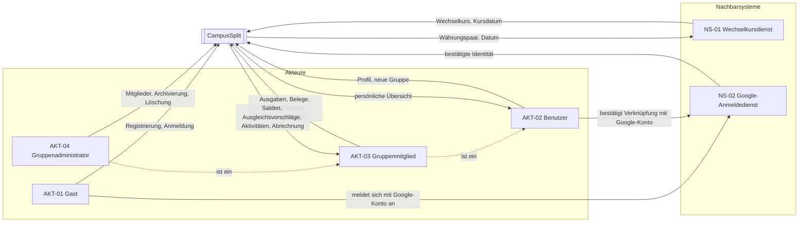

# P2 — Architekturüberblick

Dieser Baustein beschreibt grob, wie CampusSplit aufgebaut ist und mit welchen angrenzenden Systemen die Anwendung zusammenarbeitet. Es geht noch nicht um konkrete Klassen, Frameworks oder Datenbanktabellen, sondern um Systemkontext, Akteure, Schnittstellen und wichtige Datenflüsse.

---

## P2.1 Zweck

P2 zeigt CampusSplit als **Black Box** in seiner fachlichen Umgebung: wer mit dem System arbeitet (Akteure), mit welchen anderen Systemen es Informationen austauscht (Nachbarsysteme) und welche Informationen dabei fließen. Was im Inneren des Systems geschieht, beschreibt die Spezifikation in den Bausteinen F, D und B; wie es technisch aufgebaut ist, beschreibt die Architekturdokumentation. Die Einzelheiten der Schnittstellen zu den Nachbarsystemen stehen in [S1](S1_Nachbarsysteme.md); P2 gibt nur den Überblick.

## P2.2 Systemkontext

**Legende:** Der doppelt umrahmte Kasten ist CampusSplit als Black Box. Durchgezogene Pfeile zeigen einen fachlichen Informationsfluss in Pfeilrichtung, beschriftet mit der übermittelten Information. Gestrichelte Pfeile mit „ist ein“ zeigen eine Spezialisierung zwischen Akteuren: Jeder Gruppenadministrator ist ein Gruppenmitglied, jedes Gruppenmitglied ist ein Benutzer und kann alles, was ein Benutzer kann.

**Erläuterung:** Ein Gast kann sich nur registrieren oder anmelden, entweder direkt bei CampusSplit oder über sein Google-Konto. Nach der Anmeldung ist er Benutzer. Ein Benutzer pflegt sein Profil, legt Gruppen an und sieht seine persönliche Übersicht über alle seine Gruppen. Innerhalb einer Gruppe ist er Gruppenmitglied: Er erfasst Ausgaben, Belege und Rückzahlungen und erhält Salden, Ausgleichsvorschläge, Aktivitäten und die herunterladbare Abrechnung. Der Gruppenadministrator verwaltet zusätzlich die Mitglieder und den Zustand der Gruppe.

CampusSplit fragt den Wechselkursdienst nur nach dem Kurs eines Währungspaares an einem Tag. Beim Google-Anmeldedienst meldet sich die Person selbst an; CampusSplit erhält danach nur die bestätigte Identität.

## P2.3 Akteure

| ID | Akteur | Beschreibung | Spezialisierung von | Leistungsbereiche ([P1.5](P1_Ziele_und_Rahmenbedingungen.md#p15-leistungsumfang)) |
| --- | --- | --- | --- | --- |
| AKT-01 | Gast | Person, die nicht angemeldet ist. Sieht nur die Startseite und die Seiten zur Registrierung und Anmeldung. | – | LB-01 |
| AKT-02 | Benutzer | Angemeldete Person mit Benutzerkonto. Ändert ihren Anzeigenamen, verknüpft ihr Konto mit Google, legt Gruppen an und sieht die persönliche Übersicht. | – | LB-01, LB-02 (anlegen), LB-09 |
| AKT-03 | Gruppenmitglied | Benutzer in Bezug auf eine bestimmte Gruppe, der er angehört. Sieht alle Inhalte der Gruppe, erfasst, ändert und löscht Ausgaben und Belege, erfasst und storniert Rückzahlungen, an denen er selbst beteiligt ist, und lädt die Abrechnung herunter. | Benutzer | LB-03 bis LB-08, LB-10 |
| AKT-04 | Gruppenadministrator | Gruppenmitglied mit der Rolle Gruppenadministrator; das ist die Person, die die Gruppe angelegt hat. Fügt Mitglieder hinzu, archiviert die Gruppe, stellt sie wieder her oder löscht sie endgültig und darf Rückzahlungen auch für andere Mitglieder erfassen und stornieren. | Gruppenmitglied | LB-02, LB-07 |

Eine Person kann gleichzeitig in einer Gruppe Gruppenadministrator und in einer anderen Gruppe einfaches Gruppenmitglied sein. Die Rechte im Einzelnen regelt [N2](N2_Querschnittskonzepte.md).

## P2.4 Nachbarsysteme

| ID | Nachbarsystem | Zweck für CampusSplit | Erhält von CampusSplit | Liefert an CampusSplit | Auslöser | Fachliche Folge bei Ausfall |
| --- | --- | --- | --- | --- | --- | --- |
| NS-01 | Wechselkursdienst (Frankfurter, öffentlicher Dienst mit Tagesreferenzkursen) | Umrechnung von Fremdwährungsausgaben in die Gruppenwährung; Euroübersicht | Ausgangswährung, Zielwährung und gewünschtes Datum, keine Personen- oder Gruppendaten | Wechselkurs und Kursdatum | Speichern einer Fremdwährungsausgabe mit neuem Betrag, neuer Währung oder neuem Ausgabedatum; Aufruf der persönlichen Übersicht, wenn der Benutzer einer Gruppe in US-Dollar angehört | Die Fremdwährungsausgabe wird nicht gespeichert; der Benutzer erhält eine Meldung und kann es später erneut versuchen. Ausgaben in Gruppenwährung, Salden und bereits gespeicherte Kurse sind nicht betroffen. Die Euroübersicht entfällt vollständig, es werden keine Teilsummen gezeigt. |
| NS-02 | Google-Anmeldedienst (optional, siehe [RB-06](P1_Ziele_und_Rahmenbedingungen.md#p17-rahmenbedingungen)) | Anmeldung und Registrierung mit einem Google-Konto; Verknüpfung eines Benutzerkontos mit einem Google-Konto | Anmeldeanfrage von CampusSplit; die Person meldet sich bei Google selbst an | Bestätigte Identität: dauerhafte Google-Kennung, bestätigte E-Mail-Adresse, Name | Gast wählt „Mit Google anmelden“; Benutzer wählt im Profil „Mit Google verknüpfen“ | Anmeldung, Registrierung und Verknüpfung über Google sind nicht möglich. Die Anmeldung mit E-Mail und Passwort ist nicht betroffen. Benutzer ohne Passwort können sich nicht anmelden (Risiko [R-02](P1_Ziele_und_Rahmenbedingungen.md#p19-risiken)). |

Beide Dienste sind ohne Vertrag und Nutzungsentgelt nutzbar ([RB-02](P1_Ziele_und_Rahmenbedingungen.md#p17-rahmenbedingungen)). Der Wechselkursdienst erhält keine personenbezogenen Daten; Google erfährt nur, dass sich eine Person bei CampusSplit anmeldet ([RB-03](P1_Ziele_und_Rahmenbedingungen.md#p17-rahmenbedingungen)).

## P2.5 Nicht Teil des Kontexts

Die folgenden Elemente sind keine Nachbarsysteme. Sie werden hier genannt, damit die Abgrenzung eindeutig ist.

| Element | Warum kein Nachbarsystem |
| --- | --- |
| Webbrowser | Der Browser ist der Zugangsweg der Akteure, kein eigenständiges System mit eigener fachlicher Aufgabe. |
| Datenbank | Die dauerhafte Speicherung ist Bestandteil von CampusSplit und liegt innerhalb der Systemgrenze. Ihr Aufbau ist Gegenstand der Architektur. |
| Banken, Bezahl-Apps | Zahlungen finden außerhalb statt; CampusSplit hat keine Verbindung zu Zahlungsdiensten ([NZ-01](P1_Ziele_und_Rahmenbedingungen.md#p16-nichtziele)). |
| E-Mail | CampusSplit versendet keine Nachrichten ([NZ-05](P1_Ziele_und_Rahmenbedingungen.md#p16-nichtziele)). |
| Tabellenkalkulation, PDF-Anzeige | Die Benutzer öffnen heruntergeladene Abrechnungen selbst; es gibt keinen automatischen Austausch. |

## P2.6 Einbettung in die Abläufe der Gruppen

CampusSplit übernimmt in den Situationen aus [P1.2](P1_Ziele_und_Rahmenbedingungen.md#p12-typische-einsatzsituationen) jeweils einzelne Schritte. Davor liegen manuelle Tätigkeiten wie Einkaufen, Bezahlen und Aufbewahren des Belegs, danach das Übergeben oder Überweisen des Geldes und die Bestätigung durch die Beteiligten. Diese Abläufe mit ihren manuellen und unterstützten Aktivitäten beschreibt [F1](F1-geschaeftsprozesse.md).

---

## Eingesetzte KI-Werkzeuge

ChatGPT (OpenAI) wurde unterstützend für Formulierungen, Strukturierung, Mermaid-Diagramme und die Prüfung von Querverweisen verwendet. Die fachlichen Inhalte wurden anschließend mit dem Projektkontext und den übrigen Spezifikationsbausteinen abgeglichen.

